# IRIS InteropMCP

IRIS InteropMCP turns **InterSystems Interoperability Productions** into native
**Model Context Protocol (MCP) servers**. AI agents, corporate assistants and LLM-based
tools can invoke legacy Business Services through natural language — with per-tool security
guardrails and full audit — without rewriting a single line of integration code.

Built on the InterSystems AI HUB framework in ObjectScript (`%AI.ToolSet`, `%AI.Tool`,
`%AI.MCP.Service`) and deployed as a containerized workload.

## Features

- **Automatic tool discovery** — scans a running production for Business Services enabled
  via class annotations and publishes each one as an MCP tool with a typed input schema
  generated from its request message.
- **Per-tool security guardrails** — every tool is classified as `readonly` (autonomous),
  `write` (requires authorization) or `critical` (requires explicit human approval before
  execution). Critical calls are queued and never run without a recorded approval.
- **Native traceability** — every tool call drives a real message flow through the
  production (Business Service → Business Process → Business Operation), producing
  `Ens.MessageHeader` rows and a Visual Trace chain. The gateway keeps its own audit store
  (`br.musketeers.InteropMCP.Invocations`) and never writes into production structures.
- **Sync-over-async support** — tools flagged as long-running return a processing reference;
  agents poll `GetInvocationStatus` for the outcome.
- **Container-oriented** — image builds provision the MCP endpoint, demo production and
  tool catalog; production autostarts with IRIS; a sidecar supervises the MCP bridge.
- **Governance split** — the IPM module ships only the gateway application; the demo
  production lives only in the container build.

## Quick start

### 1. Download the AI Hub container image

1. Go to the [InterSystems Early Access Program Portal](https://evaluation.intersystems.com/Eval/early-access/AIHub) and download the AI Hub container for your platform.
   - File ends with `docker.tar.gz`
   - Choose **arm64** for macOS (Apple Silicon), **amd64** for Linux/Windows

2. Load the image into Docker:
   ```bash
   docker load -i /path/to/iris-community-2026.3.0AI.xxx-docker.tar.gz
   ```
   Verify with `docker images` — you should see something like:
   ```
   docker.iscinternal.com/docker-intersystems/intersystems/iris-community   2026.3.0AI.154.0   <image-id>
   ```
   > **Note:** The version includes a build number (e.g., `2026.3.0AI.154.0`), not just `2026.3.0AI`.

3. Update the `Dockerfile` in this repo — change the `FROM` line to match the exact image name printed above.

### 2. Build and start

```bash
docker compose up -d --build
```

The build provisions everything: MCP endpoint (`/mcp/interopmcp`), demo production
(`br.musketeers.InteropMCP.Demo.Production`) with the BS→BP→BO trace chain, tool catalog, and the
`iris-mcp-server` bridge (supervised).

Connect any MCP client — or opencode — to:

```
http://localhost:8080/mcp/interopmcp
```

Exposed tools (from the bundled demo production):

| Tool | Classification | Purpose |
|------|----------------|---------|
| `PayLookup` | readonly | Verify payment status for an order |
| `CustomerUpdate` | write | Update a customer's delivery address |
| `RiskCheck` | critical | Risk assessment — held for human approval |
| `BatchRun` | readonly, async | Long-running batch report generation |
| `GetInvocationStatus` | — | Poll an async/pending invocation |

Try it: invoke `PayLookup` with `{"OrderId": "88201", "CustomerId": "C-1"}`. Invoke
`RiskCheck` and observe the call being held; approve it from the IRIS terminal with
`Do ##class(br.musketeers.InteropMCP.Approvals).Approve(approvalId, "operator1")`.

## IDE Integration

For opencode, add the server to `opencode.json` and restart the session:

```json
"InteropMCP": {
  "type": "remote",
  "url": "http://localhost:8080/mcp/interopmcp",
  "enabled": true
}
```

## Architecture at a glance

```mermaid
flowchart LR
    A[MCP client / opencode] -->|JSON-RPC| B[iris-mcp-server bridge :8080]
    B --> C[Web app /mcp/interopmcp - Type 18]
    C --> D[br.musketeers.InteropMCP.MCPService - %AI.MCP.Service]
    D --> E[br.musketeers.InteropMCP.ToolSet]
    E --> F[GeneratedTools + InvocationStatusTools]
    F --> G[Guardrails]
    G -->|proceed| H[Invoker]
    H -->|fires BS only| I[Business Service]
    I -->|SendRequestSync| J[AuditProcess - BP]
    J -->|SendRequestSync| K[AuditOperation - BO]
    K --> L[^InteropMCP.Demo.AuditD payload]
    I -.-> M[Ens.MessageHeader + Visual Trace]
    H -.-> N[Invocations audit store]
```



The MCP gateway only **fires** Business Services — it never writes into production
structures. The trace is produced by the production components themselves.

## Project layout

```
src/br/musketeers/InteropMCP/    Gateway application (13 ObjectScript classes)
src/br/musketeers/InteropMCP/Demo/        Demo production + request/response classes (container demo only)
tests/br/musketeers/InteropMCP/  %UnitTest suites
python/smoke/      External MCP client smoke harness
docs/interop-mcp/  Detailed documentation
specs/001-interop-mcp/  Specification artifacts (spec, plan, contracts, tasks)
```

## Documentation

| Document | Content |
|----------|---------|
| [Architecture](docs/interop-mcp/architecture.md) | Component map, request lifecycle, traceability and security models, deployment topology |
| [Operations guide](docs/interop-mcp/operations-guide.md) | Deploy/teardown, onboarding new Business Services, approval workflow, monitoring, testing |
| [API reference](docs/interop-mcp/api-reference.md) | MCP tool contract and ObjectScript class/method reference |
| [Troubleshooting](docs/interop-mcp/troubleshooting.md) | Runbook, UDL dialect rules for this build, diagnostic queries and globals map |

## IPM module

`module.xml` packages **only** the gateway (`br.musketeers.InteropMCP.PKG`). To deploy the application
without the demo, install the module and provision the endpoint in production mode:

```objectscript
Do ##class(br.musketeers.InteropMCP.Setup).Run("prod")
```

`prod` mode requires platform authentication and a least-privilege role
(`InteropMCPRoles`); `dev` mode (used by the container demo) runs unauthenticated on
localhost only.
