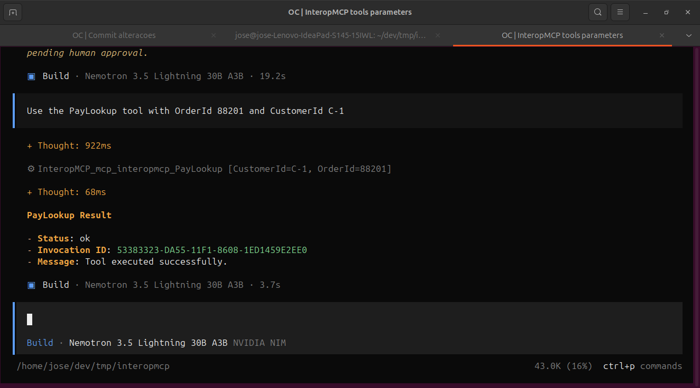
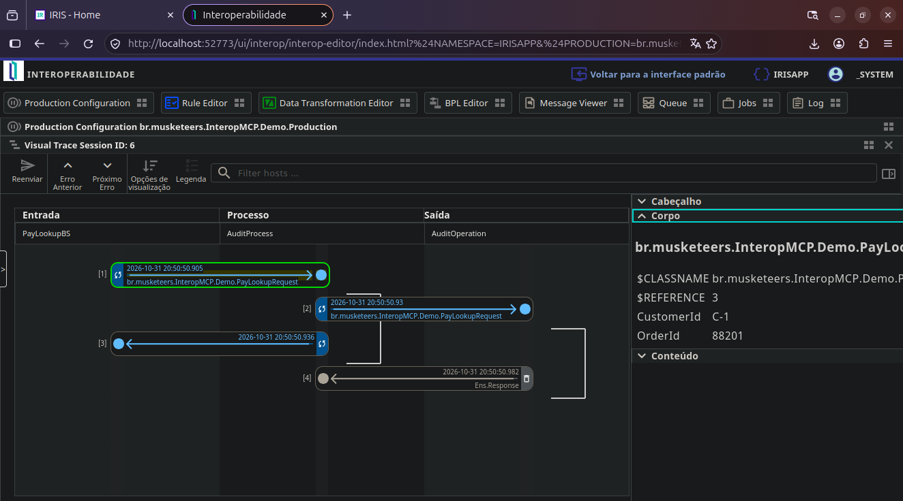
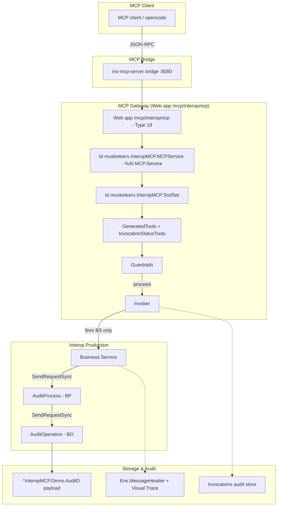

# IRIS InteropMCP

IRIS InteropMCP turns **InterSystems Interoperability Productions** into native
**Model Context Protocol (MCP) servers**. AI agents, corporate assistants and LLM-based
tools can invoke legacy Business Services through natural language — with per-tool security
guardrails and full audit — without rewriting a single line of integration code.

Built on the InterSystems AI HUB framework in ObjectScript and deployed as a containerized workload.

## Quick start

The AI Hub image is **not on Docker Hub** — you must download it from the InterSystems EAP Portal first, then load it locally.

1. **Download the AI Hub image**
   - Go to [https://evaluation.intersystems.com/Eval/early-access/AIHub](https://evaluation.intersystems.com/Eval/early-access/AIHub)
   - Download the `.docker.tar.gz` for your platform:
     - **arm64** for macOS (Apple Silicon)
     - **amd64** for Linux/Windows

2. **Load the image into Docker**

   You can download **any** AI Hub version from the EAP Portal. For convenience, use the same version as this repo (`2026.3.0AI.154.0`) — then skip step 3.

   ```bash
   docker load -i /path/to/iris-community-2026.3.0AI.154.0-docker.tar.gz
   ```
   > **Tip:** The filename matches the tag, e.g., `iris-community-2026.3.0AI.154.0-docker.tar.gz`

3. **Verify iris-main.log exists with correct ownership** (idempotent)
   
   ```bash
   [ -f iris-main.log ] || touch iris-main.log
   sudo chown 51773:51773 iris-main.log && sudo chmod 666 iris-main.log && ls -la iris-main.log
   # Expected: -rw-rw-r-- 1 51773 51773 out/date_size iris-main.log
   ```

4. **Update the Dockerfile (only if using a different version)**

   The repo's `Dockerfile` defaults to `2026.3.0AI.154.0`:
   ```dockerfile
   ARG IMAGE=docker.iscinternal.com/docker-intersystems/intersystems/iris-community:2026.3.0AI.154.0
   ```

   > **If you downloaded `2026.3.0AI.154.0` above, skip this step** — nothing to edit.

   Otherwise, edit `Dockerfile` and change the `ARG IMAGE=...` line to match your loaded image tag.

5. **Prepare credentials**
   1. Crie `.env` a partir de `.env.example` e corrija a senha da bridge:
      ```bash
      cp .env.example .env && sed -i 's/^WG_PASS=change-me/WG_PASS=SYS/' .env
      ```
      > O `WG_PASS` deve ser `SYS` (senha padrão do IRIS) para a bridge `iris-mcp-server` se conectar ao nó. Sem isso o catálogo fica vazio (`names=[]`) e chamadas de ferramentas falham com `I/O error: early eof`.

   2. Exporte a credencial de autenticação do cliente para o opencode e outros clientes MCP:
      ```bash
      export INTEROPMCP_BASIC="Basic $(printf 'mcp_demo:change-me' | base64 -w0)"
      ```
      > Adicione essa linha ao `~/.bashrc` para que o opencode (e outros clientes MCP) enviem o header `Authorization` corretamente. Essa variável é **client-side** — não é lida pelo container. Para persistir entre rebuilds, adicione ao `~/.bashrc` e abra um novo terminal.

   > `opencode.json` lê `{env:INTEROPMCP_BASIC}` do ambiente do processo no startup.
   > A transient `export` é perdida na reinicialização, e o rebuild do container não atualiza
   > `~/.bashrc`/`.env` (eles ficam fora da imagem). Persista em `~/.bashrc`, então abra um
   > novo terminal.

   6. **Start the container**

   For a clean rebuild (recommended the first time or after changes):

   ```bash
   docker compose down -v
   docker compose build --no-cache
   docker compose up -d
   ```

7. **Wait for health and verify**

   ```bash
   docker compose logs -f
   ```

   Look for `Supervising mcp-server` in `ai-hub-mcp-launcher` service.

8. **Connect your AI coding assistant to the MCP endpoint**

   The MCP server runs at `http://localhost:8080/mcp`. Configure your preferred tool:

   **opencode** (pre-configured in this repo)
   - The repo already includes `opencode.json` with InteropMCP configured
   - Just run:
     ```bash
     opencode
     ```
   - Config (`opencode.json`):
     ```json
     "InteropMCP": {
       "type": "remote",
       "url": "http://localhost:8080/mcp",
       "headers": { "Authorization": "{env:INTEROPMCP_BASIC}" },
       "enabled": true
     }
     ```

   **Claude Code**
   - Create `.mcp.json` in the repo root:
     ```json
     {
       "mcpServers": {
         "interopmcp": {
           "url": "http://localhost:8080/mcp"
         }
       }
     }
     ```
   - Restart Claude Code

   **GitHub Copilot (VS Code)**
   - Add to VS Code `settings.json`:
     ```json
     "mcp": {
       "servers": {
         "interopmcp": {
           "url": "http://localhost:8080/mcp"
         }
       }
     }
     ```
   - Reload VS Code window (Ctrl+Shift+P → "Developer: Reload Window")

6. **Test it**
    - **6.1 Invoke a tool** — in your AI assistant's chat:

      ```
      Use the PayLookup tool with OrderId 88201 and CustomerId C-1
      ```

      
    - **6.2 Verify in IRIS Management Portal**
      - Access the Message Viewer at [http://localhost:52773/csp/irisapp/EnsPortal.MessageViewer.zen?$NAMESPACE=IRISAPP&](http://localhost:52773/csp/irisapp/EnsPortal.MessageViewer.zen?$NAMESPACE=IRISAPP&)
      - Login: **_SYSTEM** / **SYS** — namespace: **IRISAPP**
      - Filter messages by today → see the `Ens.MessageHeader` entry with the BS→BP→BO chain
      - Click **Visual Trace** on that message to see the full flow: `Demo.PayLookupService` → `Demo.AuditProcess` → `Demo.AuditOperation`

      
    - **6.3 Verify audit store** (SQL):
     - Access the SQL portal at [http://localhost:52773/csp/sys/exp/%25CSP.UI.Portal.SQL.Home.zen?$NAMESPACE=IRISAPP](http://localhost:52773/csp/sys/exp/%25CSP.UI.Portal.SQL.Home.zen?$NAMESPACE=IRISAPP)
     ```sql
     SELECT * FROM br_musketeers_InteropMCP.Invocations ORDER BY InvocationId DESC
     ```
   - **6.4 Verify demo audit payload**:

     ```bash
     docker exec -it ai-hub-dev-template-iris-1 iris session iris -U IRISAPP
     ```

     Then run:
     ```objectscript
     zwrite ^InteropMCP.Demo.AuditD
     halt
     ```

**MCP endpoint:** `http://localhost:8080/mcp`

For more detailed information and additional examples, see [InteropMCP: Turn your InterSystems IRIS productions into MCP tools for AI agents](docs/articles/article-1-idea-ai-hub-tutorial.md).

## Troubleshooting / Rebuild from scratch

| Sintoma | Causa provável | Solução |
|---------|---------------|---------|
| `"InteropMCP Failed to get tools"` | `INTEROPMCP_BASIC` ausente/obsoleto no ambiente do opencode (`~/.bashrc`) | `printenv INTEROPMCP_BASIC`; corrija o bloco no `~/.bashrc` (derive do `.env`), abra um novo terminal e reinicie o opencode. Rebuild só como fallback |
| `"InteropMCP Failed to get tools"` com `INTEROPMCP_BASIC` correto | `iris-mcp-server` expõe `iris_status` com `inputSchema` vazio (`{}`), schema inválido para clientes MCP 2025-11-25 (opencode) | Suba a bridge com `run --status-tool false`; o `docker-compose.yml` já faz isso no start e no supervisor |
| Bridge descobre 0 ferramentas | `config_http.toml` sem `WG_USER`/`WG_PASS` | Crie `.env` a partir de `.env.example` e exporte `INTEROPMCP_BASIC` |
| `401` na descoberta | Credencial da bridge ausente ou inválida | Verifique `.env` e `INTEROPMCP_BASIC="Basic $(printf 'mcp_demo:change-me' | base64 -w0)"` |
| `403` na execução da ferramenta | Usuário não é membro de `InteropMCPRoles` | Use `mcp_demo` (entitled) em vez de `mcp_demo2` (unentitled) |
| Bridge não sobe | Supervisor não reinicia sozinho | `docker exec -d <container> sh -c '/usr/irissys/bin/iris-mcp-server -c /home/irisowner/dev/config_http.toml run --status-tool false > /tmp/mcp.log 2>&1'` |
| Catálogo desatualizado após rebuild | Bind-mount sobrescreve `GeneratedTools.cls` | O `BuildCatalog` roda durante o `docker build`; se necessário, re-rProvisione: `docker exec <container> iris session IRIS -U IRISAPP < bootstrap-gateway.script` |

## Features

- **Automatic tool discovery** — scans a running production for Business Services enabled
  via class annotations and publishes each one as an MCP tool with a typed input schema
  generated from its request message.
- **Per-tool security guardrails** — every tool is classified as `readonly` (autonomous),
  `write` (requires authorization) or `critical` (requires explicit human approval before
  execution). Critical calls are queued and never run without a recorded approval.
- **Native traceability** — every tool call drives a real message flow through the
  production (Business Service → Business Process → Business Operation), producing
  `Ens.MessageHeader` rows and a Visual Trace chain. The gateway keeps its own audit store
  (`br.musketeers.InteropMCP.Invocations`) and never writes into production structures.
- **Sync-over-async support** — tools flagged as long-running return a processing reference;
  agents poll `GetInvocationStatus` for the outcome.
- **Container-oriented** — image builds provision the MCP endpoint, demo production and
  tool catalog; production autostarts with IRIS; a sidecar supervises the MCP bridge.
- **Governance split** — the IPM module ships only the gateway application; the demo
  production lives only in the container build.

## Architecture at a glance



The MCP gateway only **fires** Business Services — it never writes into production
structures. The trace is produced by the production components themselves.

## Project layout

```
src/
  br/
    musketeers/
      InteropMCP/              Gateway application (13 ObjectScript classes)
      InteropMCP/Demo/         Demo production + request/response classes (container demo only)
tests/
  br/
    musketeers/
      InteropMCP/              %UnitTest suites
python/
  smoke/                       External MCP client smoke harness
docs/
  interop-mcp/                 Detailed documentation
specs/
  001-interop-mcp/             Specification artifacts (spec, plan, contracts, tasks)
```

## Documentation

| Document | Content |
|----------|---------|
| [Architecture](docs/interop-mcp/architecture.md) | Component map, request lifecycle, traceability and security models, deployment topology |
| [Operations guide](docs/interop-mcp/operations-guide.md) | Deploy/teardown, onboarding new Business Services, approval workflow, monitoring, testing |
| [API reference](docs/interop-mcp/api-reference.md) | MCP tool contract and ObjectScript class/method reference |
| [Troubleshooting](docs/interop-mcp/troubleshooting.md) | Runbook, UDL dialect rules for this build, diagnostic queries and globals map |

## IPM module

`module.xml` packages **only** the gateway (`br.musketeers.InteropMCP.PKG`). To deploy the application
without the demo, install the module and provision the endpoint in production mode:

```objectscript
Do ##class(br.musketeers.InteropMCP.Setup).Run("prod")
```

`prod` mode requires platform authentication and a least-privilege role
(`InteropMCPRoles`); `dev` mode (used by the container demo) runs unauthenticated on
localhost only.
