# IRIS InteropMCP

IRIS InteropMCP turns **InterSystems Interoperability Productions** into native
**Model Context Protocol (MCP) servers**. AI agents, corporate assistants and LLM-based
tools can invoke legacy Business Services through natural language — with per-tool security
guardrails and full audit — without rewriting a single line of integration code.

Built on the InterSystems AI HUB framework in ObjectScript (`%AI.ToolSet`, `%AI.Tool`,
`%AI.MCP.Service`) and deployed as a containerized workload.

## Quick start

The AI Hub image is **not on Docker Hub** — you must download it from the InterSystems EAP Portal first, then load it locally.

1. **Download the AI Hub image**
   - Go to [https://evaluation.intersystems.com/Eval/early-access/AIHub](https://evaluation.intersystems.com/Eval/early-access/AIHub)
   - Download the `.docker.tar.gz` for your platform:
     - **arm64** for macOS (Apple Silicon)
     - **amd64** for Linux/Windows

2. **Load the image into Docker**

   You can download **any** AI Hub version from the EAP Portal. For convenience, use the same version as this repo (`2026.3.0AI.154.0`) — then skip step 3.

   ```bash
   docker load -i /path/to/iris-community-2026.3.0AI.154.0-docker.tar.gz
   ```
   > **Tip:** The filename matches the tag, e.g., `iris-community-2026.3.0AI.154.0-docker.tar.gz`

3. **Update the Dockerfile (only if using a different version)**

   The repo's `Dockerfile` defaults to `2026.3.0AI.154.0`:
   ```dockerfile
   ARG IMAGE=docker.iscinternal.com/docker-intersystems/intersystems/iris-community:2026.3.0AI.154.0
   ```

   > **If you downloaded `2026.3.0AI.154.0` above, skip this step** — nothing to edit.

   Otherwise, edit `Dockerfile` and change the `ARG IMAGE=...` line to match your loaded image tag.

4. **Start the container**

   ```bash
   docker compose up -d --build
   ```

5. **Connect your AI coding assistant to the MCP endpoint**

   The MCP server runs at `http://localhost:8080/mcp/interopmcp`. Configure your preferred tool:

   **opencode** (pre-configured in this repo)
   - The repo already includes `opencode.json` with InteropMCP configured
   - Just run:
     ```bash
     opencode
     ```

   **Claude Code**
   - Create `.mcp.json` in the repo root:
     ```json
     {
       "mcpServers": {
         "interopmcp": {
           "url": "http://localhost:8080/mcp/interopmcp"
         }
       }
     }
     ```
   - Restart Claude Code

   **GitHub Copilot (VS Code)**
   - Add to VS Code `settings.json`:
     ```json
     "mcp": {
       "servers": {
         "interopmcp": {
           "url": "http://localhost:8080/mcp/interopmcp"
         }
       }
     }
     ```
   - Reload VS Code window (Ctrl+Shift+P → "Developer: Reload Window")

6. **Test it**
   - **6.1 Invoke a tool** — in your AI assistant's chat:

     ```
     Use the PayLookup tool with OrderId 88201 and CustomerId C-1
     ```
   - **6.2 Verify in IRIS Management Portal**
     - Go to **Interoperability → View Messages** → filter by today → see the `Ens.MessageHeader` entry with the BS→BP→BO chain
     - Click **Visual Trace** on that message to see the full flow: `Demo.PayLookupService` → `Demo.AuditProcess` → `Demo.AuditOperation`
   - **6.3 Verify audit store** (terminal):
     ```objectscript
     zn "USER"
     zwrite ^InteropMCP.Invocations
     ```
     Or via SQL:
     ```sql
     SELECT * FROM br_musketeers.InteropMCP.Invocations ORDER BY InvocationId DESC
     ```
   - **6.4 Verify demo audit payload**:
     ```objectscript
     zn "USER"
     zwrite ^InteropMCP.Demo.AuditD
     ```

**MCP endpoint:** `http://localhost:8080/mcp/interopmcp`

## Features

- **Automatic tool discovery** — scans a running production for Business Services enabled
  via class annotations and publishes each one as an MCP tool with a typed input schema
  generated from its request message.
- **Per-tool security guardrails** — every tool is classified as `readonly` (autonomous),
  `write` (requires authorization) or `critical` (requires explicit human approval before
  execution). Critical calls are queued and never run without a recorded approval.
- **Native traceability** — every tool call drives a real message flow through the
  production (Business Service → Business Process → Business Operation), producing
  `Ens.MessageHeader` rows and a Visual Trace chain. The gateway keeps its own audit store
  (`br.musketeers.InteropMCP.Invocations`) and never writes into production structures.
- **Sync-over-async support** — tools flagged as long-running return a processing reference;
  agents poll `GetInvocationStatus` for the outcome.
- **Container-oriented** — image builds provision the MCP endpoint, demo production and
  tool catalog; production autostarts with IRIS; a sidecar supervises the MCP bridge.
- **Governance split** — the IPM module ships only the gateway application; the demo
  production lives only in the container build.

## Architecture at a glance

```mermaid
flowchart LR
    A[MCP client / opencode] -->|JSON-RPC| B[iris-mcp-server bridge :8080]
    B --> C[Web app /mcp/interopmcp - Type 18]
    C --> D[br.musketeers.InteropMCP.MCPService - %AI.MCP.Service]
    D --> E[br.musketeers.InteropMCP.ToolSet]
    E --> F[GeneratedTools + InvocationStatusTools]
    F --> G[Guardrails]
    G -->|proceed| H[Invoker]
    H -->|fires BS only| I[Business Service]
    I -->|SendRequestSync| J[AuditProcess - BP]
    J -->|SendRequestSync| K[AuditOperation - BO]
    K --> L[^InteropMCP.Demo.AuditD payload]
    I -.-> M[Ens.MessageHeader + Visual Trace]
    H -.-> N[Invocations audit store]
```



The MCP gateway only **fires** Business Services — it never writes into production
structures. The trace is produced by the production components themselves.

## Project layout

```
src/br/musketeers/InteropMCP/    Gateway application (13 ObjectScript classes)
src/br/musketeers/InteropMCP/Demo/        Demo production + request/response classes (container demo only)
tests/br/musketeers/InteropMCP/  %UnitTest suites
python/smoke/      External MCP client smoke harness
docs/interop-mcp/  Detailed documentation
specs/001-interop-mcp/  Specification artifacts (spec, plan, contracts, tasks)
```

## Documentation

| Document | Content |
|----------|---------|
| [Architecture](docs/interop-mcp/architecture.md) | Component map, request lifecycle, traceability and security models, deployment topology |
| [Operations guide](docs/interop-mcp/operations-guide.md) | Deploy/teardown, onboarding new Business Services, approval workflow, monitoring, testing |
| [API reference](docs/interop-mcp/api-reference.md) | MCP tool contract and ObjectScript class/method reference |
| [Troubleshooting](docs/interop-mcp/troubleshooting.md) | Runbook, UDL dialect rules for this build, diagnostic queries and globals map |

## IPM module

`module.xml` packages **only** the gateway (`br.musketeers.InteropMCP.PKG`). To deploy the application
without the demo, install the module and provision the endpoint in production mode:

```objectscript
Do ##class(br.musketeers.InteropMCP.Setup).Run("prod")
```

`prod` mode requires platform authentication and a least-privilege role
(`InteropMCPRoles`); `dev` mode (used by the container demo) runs unauthenticated on
localhost only.
