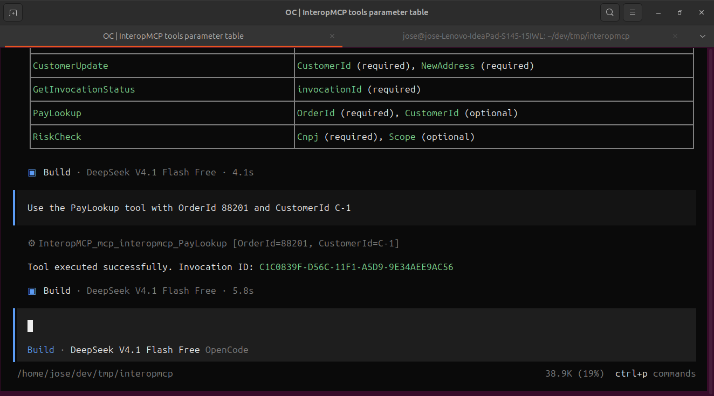
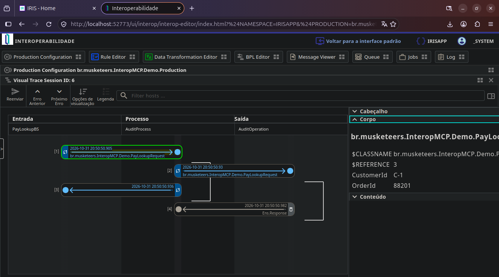
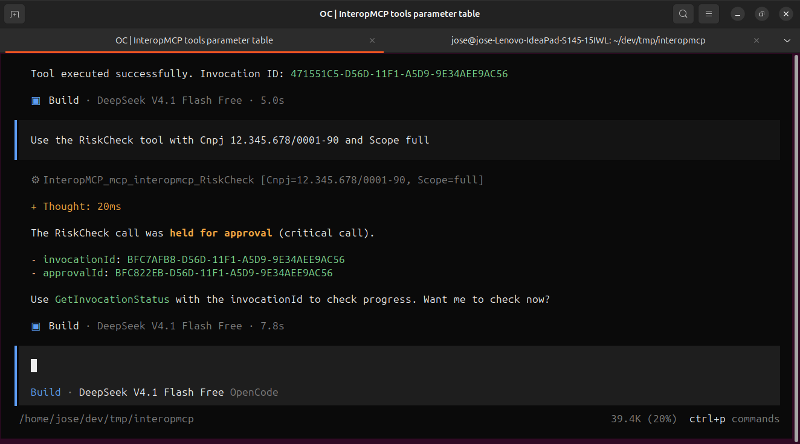
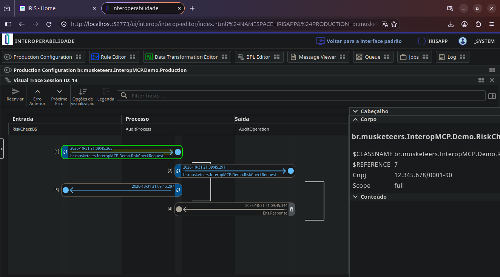
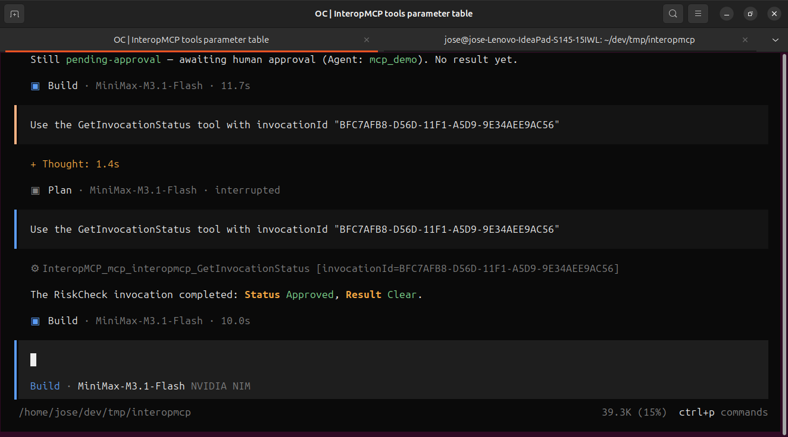

# InteropMCP: Turn your InterSystems IRIS productions into MCP tools for AI agents

**Resumo executivo / Executive summary**

- The IRIS InteropMCP exposes Business Services from an InterSystems IRIS Interoperability Production as native Model Context Protocol (MCP) tools.
- No integration code needs to be rewritten: the gateway invokes your existing Business Service through `CreateBusinessService` + `ProcessInput` and preserves native traceability (`Ens.MessageHeader`, Visual Trace).
- Built on the InterSystems **AI HUB** framework (ObjectScript), deployed as a containerized workload.
- Two separate audit planes: production-native (messages produced by the BS → BP → BO flow) and gateway-side (tool-call lifecycle, guardrail decisions, human approvals).

---

## 1. The problem

Many organizations run valuable business logic inside InterSystems IRIS Interoperability Productions: payment validation, customer address updates, risk assessments, batch processing, etc. Making this logic available to an AI assistant usually means writing new REST endpoints, adapting request schemas, and maintaining parallel integrations — manual, error-prone, and outside the production's native traceability.

## 2. The idea: a non-invasive gateway

InteropMCP flips this model. Instead of building new integrations, it **exposes what already exists** as MCP tools:

1. A Business Service annotated with class parameters (`AIGATEWAY`, `AIGATEWAYDESC`, `REQUESTCLASS`) is discovered automatically by the registry (`br.musketeers.InteropMCP.Registry`).
2. The registry generates and compiles a tools class (`br.musketeers.InteropMCP.GeneratedTools`) — one typed ClassMethod per Business Service.
3. An AI agent calls the tool by natural language (e.g. *"check payment for order 88201, customer C-1"*).
4. The gateway fires only the target Business Service. The production runs its normal flow (BS → BP → BO), creating `Ens.MessageHeader` rows and a Visual Trace exactly as before.

Removing the gateway changes nothing about the production itself (zero-regression requirement).

## 3. How AI HUB helps

InteropMCP is built on the **InterSystems AI HUB** framework in ObjectScript. The AI HUB provides the pieces that would otherwise be complex to build from scratch:

- **MCP dispatch:** The web app `/mcp/interopmcp` (type 18) is served by `br.musketeers.InteropMCP.MCPService`, which derives from `%AI.MCP.Service` and handles JSON-RPC from MCP clients (via the `iris-mcp-server` bridge on port 8080).
- **Tool catalog:** `br.musketeers.InteropMCP.ToolSet` declares the exposed tools, bound to the service `SPECIFICATION`. Each Business Service becomes a ClassMethod whose input schema is generated from its `Ens.Request` subclass (`br.musketeers.InteropMCP.SchemaMapper` maps request properties to the tool input schema).
- **Execution:** `br.musketeers.InteropMCP.Invoker` instantiates the typed request, fills properties from the call arguments, and invokes the Business Service via `Ens.Director`. The `%Status` result is serialized by the AI HUB layer into the MCP `tools/call` result.

## 4. Tutorial: run the demo and call the tools

All steps below were validated against a running InteropMCP container (`ai-hub-dev-template-iris-1`) exposing the MCP endpoint at `http://localhost:8080/mcp`.

### Prerequisites

- The InteropMCP container is up and healthy.
- Demo credential: user `mcp_demo` / password `change-me` (member of `InteropMCPRoles`, entitled to call tools).
- AI agent: Opencode, Claude Code, GitHub Copilot or other MCP-compatible client with a model that supports tool calling/MCP. In the tests for this article the models "DeepSeek 4.1 Flash", "MiniMax-M3.1-Flash" and "Nemotron 3.5 Lightning 30B A3B" were used.
- Note: due to the non-deterministic nature of language models, results may differ between runs.

### Step 0: Build the Basic auth header

The MCP endpoint requires an `Authorization: Basic <base64>` header.

```bash
export INTEROPMCP_BASIC="Basic $(printf 'mcp_demo:change-me' | base64 -w0)"
echo $INTEROPMCP_BASIC
# Result: Basic bWNwX2RlbW86Y2hhbmdlLW1l
```

Now, build the image and start the container:

```bash
docker compose down -v
docker compose build --no-cache
docker compose up -d
```

Wait ~30s for health and verify with `docker exec ai-hub-dev-template-iris-1 sh -c 'tail -n 30 /tmp/mcp.log'`.

*For more information, see the project on InterSystems OpenExchange.*

### Step 1: Configure Opencode

The repo already includes `opencode.json` with InteropMCP configured as remote:

```json
"InteropMCP": {
  "type": "remote",
  "url": "http://localhost:8080/mcp",
  "headers": { "Authorization": "{env:INTEROPMCP_BASIC}" },
  "enabled": true
}
```

Make sure `INTEROPMCP_BASIC` is exported in the shell that starts Opencode, e.g. in `~/.bashrc`:
```bash
export INTEROPMCP_BASIC="Basic $(printf 'mcp_demo:change-me' | base64 -w0)"
```

Start Opencode:
```bash
opencode
```

Then enter the commands `/mcps` and `/status`. You should see outputs like `iris-agentic-dev connected ✓ Enabled ` and `InteropMCP Connected`, respectively.


### Step 2: List tools with Opencode

In Opencode, the tools are discovered automatically. Ask in chat:

`List the available InteropMCP tools in table with tool name and thier parameters`

Expected result (5 tools from the demo production):

| Tool | Parameters |
|------|------------|
| `PayLookup` | `OrderId` (required), `CustomerId` |
| `CustomerUpdate` | `CustomerId`, `NewAddress` |
| `BatchRun` | `ReportSet` (required) |
| `RiskCheck` | `Cnpj` (required), `Scope` |
| `GetInvocationStatus` | `invocationId` (required) |

> **Note on `Cnpj`**: `Cnpj` is the Brazilian company identification number, equivalent to the Employer Identification Number – EIN – in the US. In the demo environment use a valid example CNPJ; for a US context think of EIN as the analogous parameter.


### Step 3: Call a readonly tool — PayLookup with Opencode

`Use the PayLookup tool with OrderId 88201 and CustomerId C-1`

Expected: `isError:false`, content type text with a JSON object:
```json
{
  "_status": "ok",
  "invocationId": "<INVOCATION_ID>",
  "message": "Tool executed successfully."
}
```
The Business Service executes immediately and the invocation is recorded in the audit store.



You can check the interoperability invockation in the Interoperability Portal:



### Step 4: Call a write tool — CustomerUpdate with Opencode

`Use the CustomerUpdate tool with CustomerId 1 and NewAddress "Av. Paulista, 1000 - São Paulo/SP"`

Expected: `isError:false`, content type text with a JSON object:
```json
{
  "_status": "ok",
  "invocationId": "<INVOCATION_ID>",
  "message": "Tool executed successfully."
}
```
The write operation is executed and logged by the guardrail.


### Step 5: Call a critical tool — RiskCheck with Opencode

`Use the RiskCheck tool with Cnpj 12.345.678/0001-90 and Scope full`

Expected: `isError:false`, content type text with a JSON object:

```json
{
  "_status": "held",
  "invocationId": "<INVOCATION_ID>",
  "approvalId": "<APPROVAL_ID>",
  "message": "Critical call held for approval. Use GetInvocationStatus with invocationId to check progress."
}
```

The call returns a held status and does **not** execute the Business Service — it is parked awaiting human approval. Capture `invocationId` and `approvalId` for the next steps.





### Step 6: Check invocation status with Opencode

`Use the GetInvocationStatus tool with invocationId "<INVOCATION_ID>"`

Replace <INVOCATION_ID> with the GUID returned in Step 5. A held critical call returns:

```json
{
  "columns": [...],
  "rows": [{"InvocationId":"<INVOCATION_ID>","Status":"pending-approval","Result":"","AgentIdentity":"local-dev"}],
  "text": "Invocation <INVOCATION_ID> – Status: pending-approval | Agent: local-dev | Awaiting human approval"
}
```

After approval, the same call will show `"Status":"completed"` and include the result in the `text` summary.


This tool has no IRIS Interoperability invocation, it's a InteropMCP internal call. So there is no Interoperability trace to show.

### Step 7: Approve the critical call (human operator)

An operator reviews pending approvals and decides:

```bash
docker exec -it ai-hub-dev-template-iris-1 iris session iris -U IRISAPP
```

```objectscript
// List pending approvals
Set pend = ""
Do ##class(br.musketeers.InteropMCP.Approvals).ListPending(.pend)
Write pend.%ToJSON(), !

// Use the approvalId returned in Step 5
Set ApprovalId = pend.pending.%Get(0)

// Approve a specific approval
Do ##class(br.musketeers.InteropMCP.Approvals).Approve(ApprovalId, "operator1")

// Or reject
// Do ##class(br.musketeers.InteropMCP.Approvals).Reject(ApprovalId, "operator1", "policy violation")

Halt
```

Every decision is written to the gateway audit log (`br.musketeers.InteropMCP.Log`) and to the `br_musketeers_InteropMCP.Approvals` table.

**7b. Verify execution after approval**

`Use the GetInvocationStatus tool with invocationId "<INVOCATION_ID>"` again. After approval the status should be `"completed"` and the `text` field will contain a human-readable summary with the result.



## 5. Hypothetical example: retail payment & address flow

Imagine a retail chain running the demo production `br.musketeers.InteropMCP.Demo.Production`:

| Item | Class | Role |
|------|-------|------|
| `PayLookupBS` | `...Demo.PayLookupBS` | Check payment status (`readonly`) |
| `CustomerUpdateBS` | `...Demo.CustomerUpdateBS` | Update delivery address (`write`) |
| `RiskCheckBS` | `...Demo.RiskCheckBS` | Critical risk assessment (`critical`) |
| `AuditProcess` / `AuditOperation` | BP / BO | Native production trace |

**Scenario:** A finance assistant answers whether invoice 88201 was paid and, if asked, updates the customer's delivery address.

1. Agent: *"Has order 88201 for customer C-1 been paid?"* → calls `mcp_interopmcp_PayLookup` → production returns `Status: Compensated | Paid: Yes | Amount: 150.75`.
2. Agent: *"Update customer 1's address to Av. Paulista, 1000."* → calls `mcp_interopmcp_CustomerUpdate` → production writes the update, gateway logs the caller identity (`mcp_demo`) and parameters.
3. Agent: *"Run a risk check on CNPJ 12.345.678/0001-90."* → calls `mcp_interopmcp_RiskCheck` → gateway returns `_status: held` with `invocationId` and `approvalId`. The call is not executed; it is parked as `pending-approval`. A human operator reviews and calls `Approvals.Approve(approvalId, "operator1")`. The gateway replays the original call with the same `invocationId` and updates status to `completed`.

All three calls are visible in the Message Viewer and Visual Trace as genuine BS → BP → BO message flows — produced by the production, not by the gateway.

## 6. What this means

InteropMCP lets AI agents talk to your existing InterSystems IRIS integrations without rewriting them, while keeping authentication, per-tool guardrails, and dual-plane auditability. The next article covers the security and authentication model in depth.

---
*This article was drafted with AI assistance and reviewed by the author.*

**Repository:** `src/br/musketeers.InteropMCP/` — see `Setup.cls`, `Registry.cls`, `Guardrails.cls`, `Invoker.cls`, `GeneratedTools.cls` and `docs/interop-mcp/architecture.md`.
