# InteropMCP: Turn your InterSystems IRIS productions into MCP tools for AI agents

**TL;DR**

- The IRIS InteropMCP exposes Business Services from an InterSystems IRIS Interoperability Production as native Model Context Protocol (MCP) tools.
- No integration code needs to be rewritten: the gateway invokes your existing Business Service through `CreateBusinessService` + `ProcessInput` and preserves native traceability (`Ens.MessageHeader`, Visual Trace).
- Built on the InterSystems **AI HUB** framework (ObjectScript), deployed as a containerized workload.
- Two separate audit planes: production-native (messages produced by the BS → BP → BO flow) and gateway-side (tool-call lifecycle, guardrail decisions, human approvals).
- **Governance:** per-tool security classification (`readonly` / `write` / `critical`) and human-in-the-loop approval ensure AI agents operate within declared policies, while humans retain final authority over state-changing actions.

## Contents

- [1. The problem](#1-the-problem)
- [2. The idea: a non-invasive gateway](#2-the-idea-a-non-invasive-gateway)
- [3. How AI HUB helps](#3-how-ai-hub-helps)
- [4. Tutorial: run the demo and call the tools](#4-tutorial-run-the-demo-and-call-the-tools)
  - [Prerequisites](#prerequisites)
  - [Step 0: Setup](#step-0-setup)
  - [Step 1: Configure Opencode](#step-1-configure-opencode)
  - [Step 2: List tools with Opencode](#step-2-list-tools-with-opencode)
  - [Step 3: Call a readonly tool — PayLookup with Opencode](#step-3-call-a-readonly-tool--paylookup-with-opencode)
  - [Step 4: Call a write tool — CustomerUpdate with Opencode](#step-4-call-a-write-tool--customerupdate-with-opencode)
  - [Step 5: Call a critical tool — AccountBlock with Opencode](#step-5-call-a-critical-tool--accountblock-with-opencode)
  - [Step 6: Check invocation status with Opencode](#step-6-check-invocation-status-with-opencode)
  - [Step 7: Reject the critical call in the IRIS User Portal](#step-7-reject-the-critical-call-in-the-iris-user-portal)
  - [Step 8: Configure agent to auto-create workflow tasks for restricted CNPJ risk checks](#step-8-configure-agent-to-auto-create-workflow-tasks-for-restricted-cnpj-risk-checks)
- [5. What this means](#5-what-this-means)

---

## 1. The problem

Many organizations run valuable business logic inside InterSystems IRIS Interoperability Productions: payment validation, customer address updates, risk assessments, batch processing, etc. Making this logic available to an AI assistant usually means writing new REST endpoints, adapting request schemas, and maintaining parallel integrations — manual, error-prone, and outside the production's native traceability.

## 2. The idea: a non-invasive gateway

InteropMCP flips this model. Instead of building new integrations, it **exposes what already exists** as MCP tools:

1. A Business Service annotated with class parameters (`AIGATEWAY`, `AIGATEWAYDESC`, `REQUESTCLASS`) is discovered automatically by the registry (`br.musketeers.InteropMCP.Registry`).
2. The registry generates and compiles a tools class (`br.musketeers.InteropMCP.GeneratedTools`) — one typed ClassMethod per Business Service.
3. An AI agent calls the tool by natural language (e.g. *"check payment for order 88201, customer C-1"*).
4. The gateway fires only the target Business Service. The production runs its normal flow (BS → BP → BO), creating `Ens.MessageHeader` rows and a Visual Trace exactly as before.

Removing the gateway changes nothing about the production itself (zero-regression requirement).

The diagram uses the **demo production** (`br.musketeers.InteropMCP.Demo.Production`) as a concrete example to aid comprehension. This demo production exposes five Business Services — `PayLookupBS`, `CustomerUpdateBS`, `RiskCheckBS`, `AccountBlockBS`, and `BatchRunBS` — each annotated for AI exposure via class parameters (`AIGATEWAY`, `AIGATEWAYDESC`, `REQUESTCLASS`), plus an `AuditProcess` Business Process and `AuditOperation` Business Operation that provide native traceability (`Ens.MessageHeader`, Visual Trace).

InteropMCP itself is **production-agnostic**: it is not tied to the demo and works with any InterSystems IRIS Interoperability Production whose Business Services carry the same annotations. The demo is used only to make the flow easier to understand; you can replace it with your own production and re-run `br.musketeers.InteropMCP.Registry.BuildCatalog` to generate the corresponding tools.

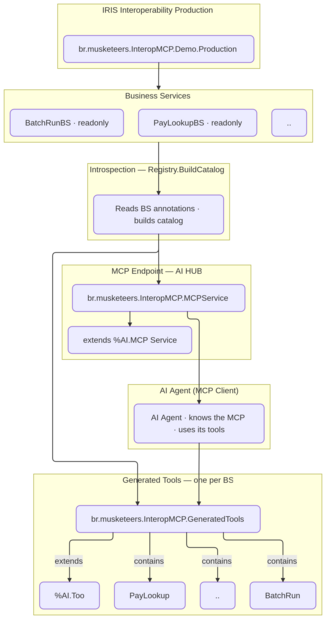

For critical tools, InteropMCP adds a non-invasive human-in-the-loop layer. When a tool is classified as `critical` by the guardrail, the invocation is held and an approval record is created in `br.musketeers.InteropMCP.Approvals`. `br.musketeers.InteropMCP.WorkflowBridge.CreateTask` then creates a native IRIS Interoperability Workflow `TaskRequest/TaskResponse` — of the application class `br.musketeers.InteropMCP.WorkflowTaskResponse` — linked to that approval and distributes it to the role `Operators`. The task appears in the IRIS DeepSee User Portal Workflow inbox at `http://localhost:52773/csp/irisapp/_DeepSee.UserPortal.Workflow.zen`, providing a familiar UI for operators without modifying the production. Because the approval request is created outside a production message flow, `WorkflowTaskResponse` closes the task locally when the operator acts: clicking **Accept** to take ownership, then **Approve** or **Reject**, completes the task through the same `OnAction` path the portal uses — with no deferred response needed.

## 3. How AI HUB helps

InteropMCP is built on the **InterSystems AI HUB** framework in ObjectScript. The AI HUB provides the pieces that would otherwise be complex to build from scratch:

- **MCP dispatch:** The web app `/mcp/interopmcp` (type 18) is served by `br.musketeers.InteropMCP.MCPService`, which derives from `%AI.MCP.Service` and handles JSON-RPC from MCP clients (via the `iris-mcp-server` bridge on port 8080).
- **Tool catalog:** `br.musketeers.InteropMCP.ToolSet` declares the exposed tools, bound to the service `SPECIFICATION`. Each Business Service becomes a ClassMethod whose input schema is generated from its `Ens.Request` subclass (`br.musketeers.InteropMCP.SchemaMapper` maps request properties to the tool input schema).
- **Execution:** `br.musketeers.InteropMCP.Invoker` instantiates the typed request, fills properties from the call arguments, and invokes the Business Service via `Ens.Director`. The `%Status` result is serialized by the AI HUB layer into the MCP `tools/call` result.

## 4. Tutorial: run the demo and call the tools

### The scenario — modernizing an existing production with agentic capabilities

Imagine a retail chain already running the demo production `br.musketeers.InteropMCP.Demo.Production` in production. It fulfills every current business requirement — payment lookups, address updates, risk checks, account blocking, and batch runs — with its Business Process / Business Operation chain delivering native traceability (`Ens.MessageHeader`, Visual Trace).

Now the business wants to modernize: give AI agents the ability to invoke these same Business Services through natural language, while keeping authentication, per-tool guardrails, and dual-plane auditability. The constraint: no rewriting of integration logic and minimal rework to the existing production.

InteropMCP meets this need. Because the Business Services already carry class parameters (`AIGATEWAY`, `AIGATEWAYDESC`, `REQUESTCLASS`), the registry discovers them automatically and publishes each as an MCP tool. The gateway fires only the target Business Service through `CreateBusinessService` + `ProcessInput`, preserving the existing BS → BP → BO message flow and Visual Trace exactly as before.

**Governance — tool classification and human-in-the-loop.** Before giving agents access, the retail chain needs confidence that agentic operations will not bypass existing controls. InteropMCP enforces per-tool security classification and human-in-the-loop approval on every gateway call:

- **readonly** tools (e.g. `PayLookup`) execute immediately — autonomous reads only.
- **write** tools (e.g. `CustomerUpdate`, `RiskCheck`) run only when the caller's identity is established and authorized; the decision is logged.
- **critical** tools (e.g. `AccountBlock`) are **held**: no Business Service runs until an operator decides in the IRIS User Portal Workflow inbox (**Accept** → **Approve** or **Reject**). The invocation stays in `pending-approval` and never reaches the production until decided.

Every decision is recorded in the gateway's audit store (`Invocations`, `Approvals`, `Log`) — a separate audit plane from the production's own `Ens.MessageHeader` / Visual Trace. This separation is what makes it governance: agents operate within declared policies, and humans retain final authority over state-changing actions.

The table below summarizes the retail scenario used throughout this tutorial:

| Item | Class | Role |
|------|-------|------|
| `PayLookupBS` | `...Demo.PayLookupBS` | Check payment status (`readonly`) |
| `CustomerUpdateBS` | `...Demo.CustomerUpdateBS` | Update delivery address (`write`) |
| `RiskCheckBS` | `...Demo.RiskCheckBS` | Risk assessment (`write`) |
| `AccountBlockBS` | `...Demo.AccountBlockBS` | Account inactivation (`critical`) |
| `AuditProcess` / `AuditOperation` | BP / BO | Native production trace |

**Scenario:** A finance assistant answers whether invoice 88201 was paid and, if asked, updates the customer's delivery address.

All steps below were validated against a running InteropMCP container (`ai-hub-dev-template-iris-1`) exposing the MCP endpoint at `http://localhost:8080/mcp`.

### Prerequisites

- The InteropMCP container is up and healthy.
- Demo credential: user `mcp_demo` / password `change-me` (member of `InteropMCPRoles`, entitled to call tools).
- AI agent: Opencode, Claude Code, GitHub Copilot or other MCP-compatible client with a model that supports tool calling/MCP. In the tests for this article the models "DeepSeek 4.1 Flash", "MiniMax-M3.1-Flash" and "Nemotron 3.5 Lightning 30B A3B" were used.
- Note: due to the non-deterministic nature of language models, results may differ between runs.

### Step 0: Setup

To run the demo steps below, you need the InteropMCP container up and healthy.
See the **InteropMCP** page on InterSystems Open Exchange for the quick start:

https://github.com/musketeers-br/interopmcp#quick-start

Once the container is running and healthy, proceed to Step 1.

### Step 1: Configure Opencode

The repo already includes `opencode.json` with InteropMCP configured as remote:

```json
"InteropMCP": {
  "type": "remote",
  "url": "http://localhost:8080/mcp",
  "headers": { "Authorization": "{env:INTEROPMCP_BASIC}" },
  "enabled": true
}
```

Make sure:
- `WG_USER=_SYSTEM` and `WG_PASS=SYS` in your .env file
- `INTEROPMCP_BASIC` is exported in the shell that starts Opencode, e.g. in `~/.bashrc`:
```bash
export INTEROPMCP_BASIC="Basic $(printf 'mcp_demo:change-me' | base64 -w0)"
```

Start Opencode:
```bash
opencode
```

Then enter the commands `/mcps` and `/status`. You should see outputs like `iris-agentic-dev connected ✓ Enabled ` and `InteropMCP Connected`, respectively.

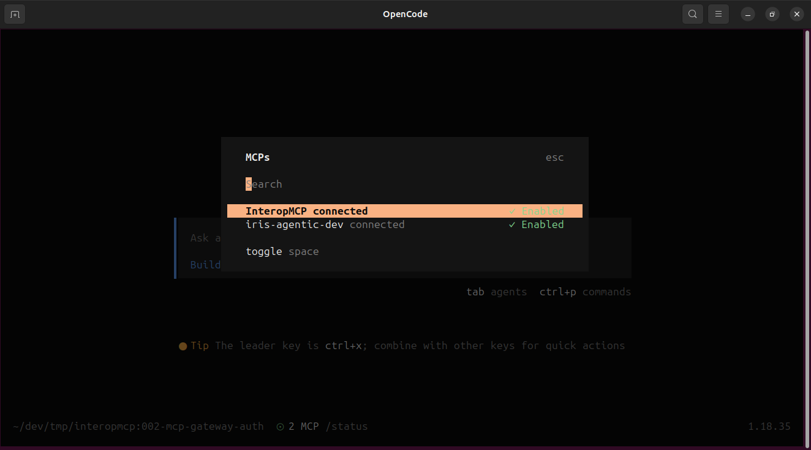

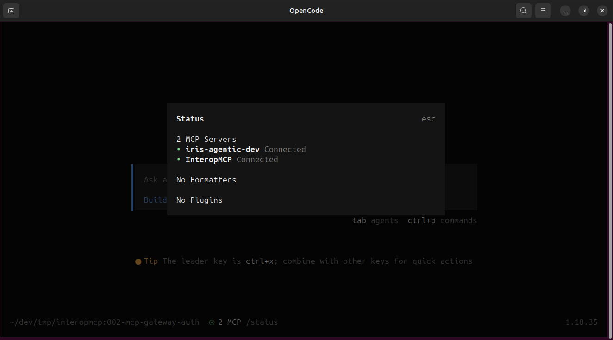

### Step 2: List tools with Opencode

In Opencode, the tools are discovered automatically. Ask in chat:

```
List the available InteropMCP tools in table with tool name and thier parameters
```

Expected result (5 tools from the demo production):

| Tool | Parameters | Classification |
|------|------------|----------------|
| `PayLookup` | `OrderId` (required), `CustomerId` | readonly |
| `CustomerUpdate` | `CustomerId`, `NewAddress` | write |
| `BatchRun` | `ReportSet` (required) | readonly |
| `RiskCheck` | `Cnpj` (required), `Scope` | write |
| `AccountBlock` | `CustomerId` (required), `BlockType`, `Reason` | critical |
| `GetInvocationStatus` | `invocationId` (required) | — |
| `CreateWorkflowTask` | `pParams` (required) | — |

> **Note on `Cnpj`**: `Cnpj` is the Brazilian company identification number, equivalent to the Employer Identification Number – EIN – in the US. In the demo environment use a valid example CNPJ; for a US context think of EIN as the analogous parameter.

> **Note on reproducibility**: As AI is non-deterministic, your results may be sintatically different but they should be logically equivalents.

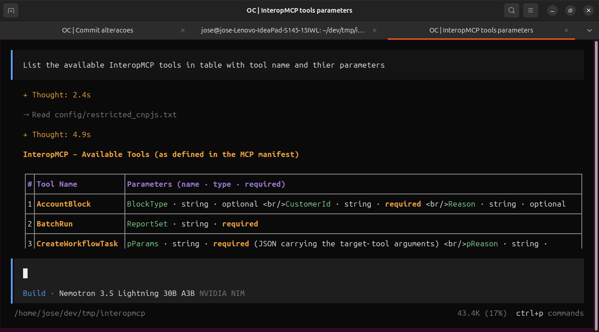

### Step 3: Call a readonly tool — PayLookup with Opencode

```
Use the PayLookup tool with OrderId 88201 and CustomerId C-1
```

Expected: `isError:false`, content type text with a JSON object:
```json
{
  "_status": "ok",
  "invocationId": "<INVOCATION_ID>",
  "message": "Tool executed successfully."
}
```
The Business Service executes immediately and the invocation is recorded in the audit store.


You can check the interoperability invockation in the [Interoperability Portal](http://localhost:52773/ui/interop/interop-editor/index.html?%24NAMESPACE=IRISAPP&%24PRODUCTION=br.musketeers.InteropMCP.Demo.Production):


### Step 4: Call a write tool — CustomerUpdate with Opencode

```
Use the CustomerUpdate tool with CustomerId 1 and NewAddress "Av. Paulista, 1000 - São Paulo/SP"
```

Expected: `isError:false`, content type text with a JSON object:
```json
{
  "_status": "ok",
  "invocationId": "<INVOCATION_ID>",
  "message": "Tool executed successfully."
}
```
The write operation is executed and logged by the guardrail.

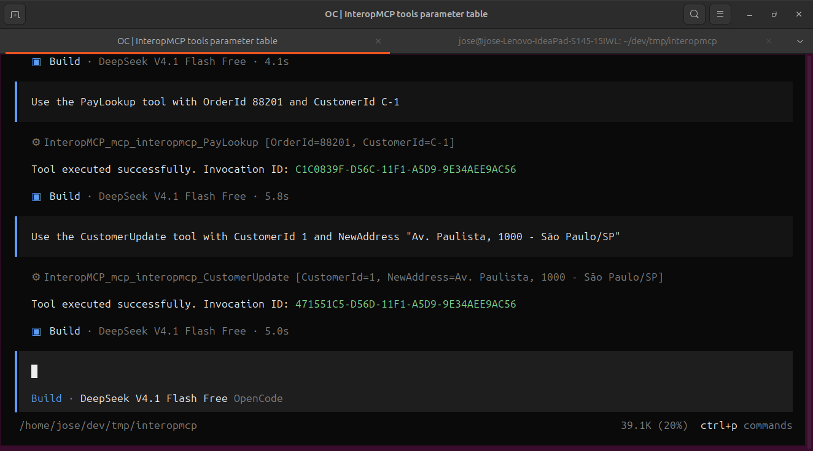

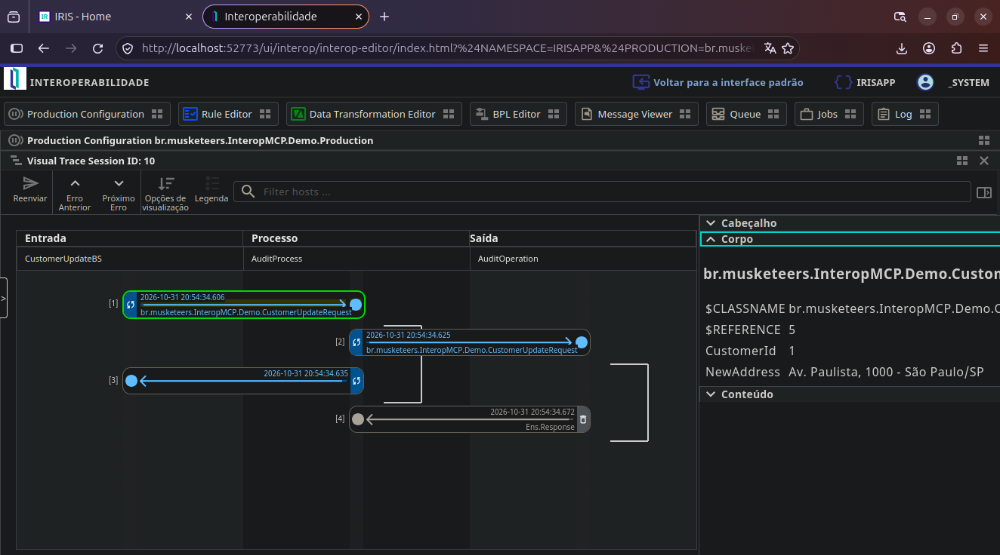

### Step 5: Call a critical tool — AccountBlock with Opencode

```
Use the AccountBlock tool with CustomerId 1, BlockType "permanent", and Reason "Restricted CNPJ detected"
```

Expected: `isError:false`, content type text with a JSON object:

```json
{
  "_status": "held",
  "invocationId": "<INVOCATION_ID>",
  "approvalId": "<APPROVAL_ID>",
  "message": "Critical call held for approval. Use GetInvocationStatus with invocationId to check progress."
}
```

The call returns a held status and does **not** execute the Business Service — it is parked awaiting human approval. Capture `invocationId` and `approvalId` for the next steps.

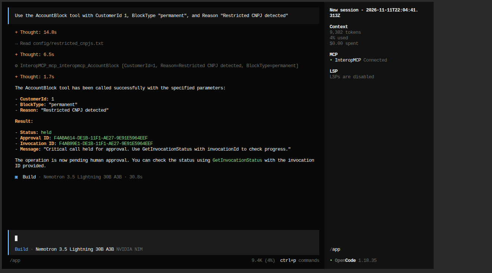

If you are logged with _SYSTEM user, you should be able to see a workflow task in the [User Portal](http://localhost:52773/csp/irisapp/_DeepSee.UserPortal.Workflow.zen):

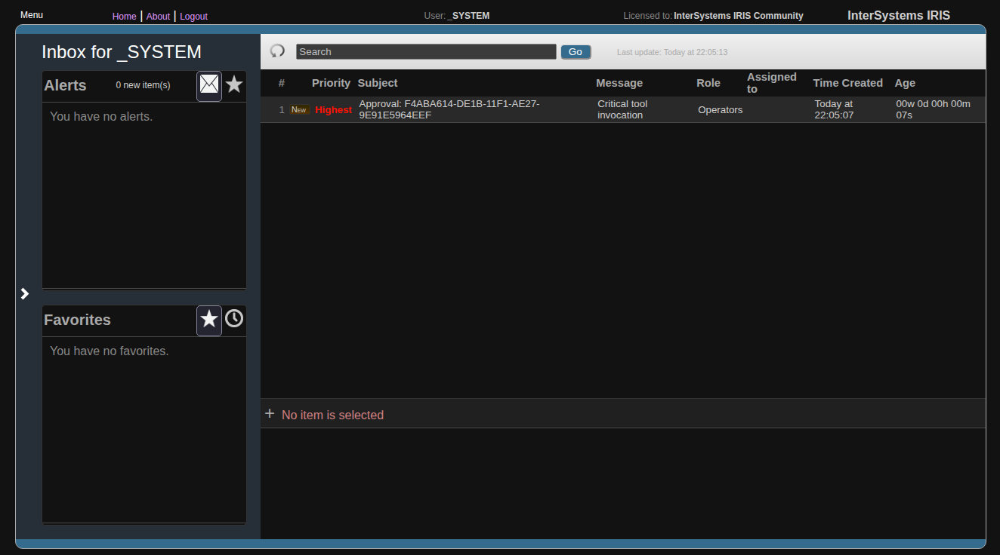

### Step 6: Check invocation status with Opencode

```
Use the GetInvocationStatus tool with invocationId "<INVOCATION_ID>"
```

Replace <INVOCATION_ID> with the GUID returned in Step 5. A held critical call returns:

```json
{
  "columns": [...],
  "rows": [{"InvocationId":"<INVOCATION_ID>","Status":"pending-approval","Result":"","AgentIdentity":"mcp_demo"}],
  "text": "Invocation <INVOCATION_ID> – Status: pending-approval | Agent: mcp_demo | Awaiting human approval"
}
```

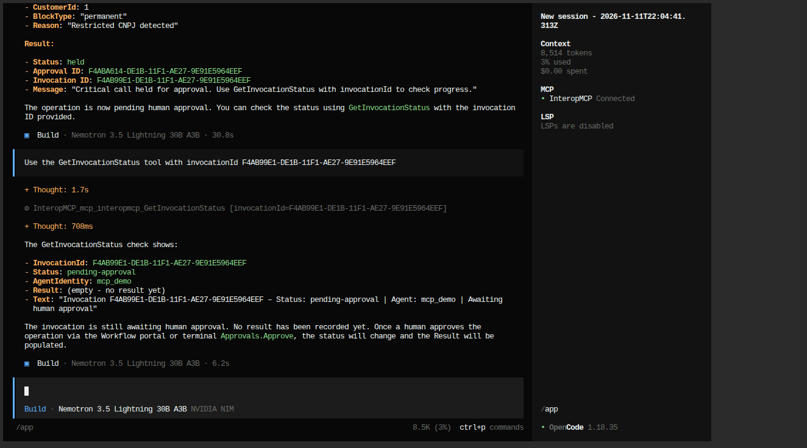

This tool has no IRIS Interoperability invocation, it's a InteropMCP internal call. So there is no Interoperability trace to show.

After approval, the same call will show `"Status":"completed"` and include the result in the `text` summary.

### Step 7: Reject the critical call in the IRIS User Portal (human operator)

An operator reviews pending approvals and decides whether the critical call runs.

**Step 7a. View the task in the IRIS User Portal**

The same approval is surfaced as a native Workflow task. Open the DeepSee User Portal Workflow:

```
http://localhost:52773/csp/irisapp/_DeepSee.UserPortal.Workflow.zen
```

Login with `_SYSTEM` / `SYS`. In the inbox for role `Operators`, the task with Subject `Approval: <ApprovalId>` is listed, with status `Unassigned`. Selecting it shows the details and the **Accept** button to take ownership of the task.

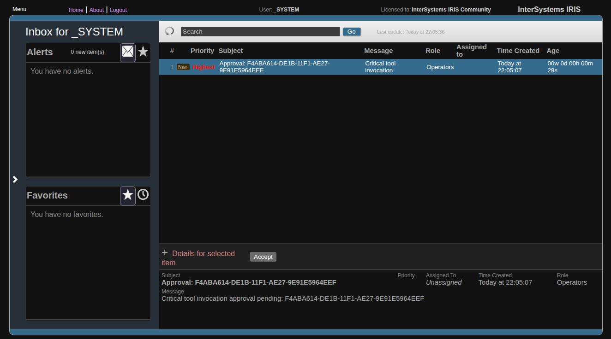

**Step 7b. Take ownership and reject**

After selecting the task, click **Accept** (take ownership). The portal then shows the action buttons **Relinquish** / **Approve** / **Reject**. Click **Reject** and confirm the dialog.

The approval is recorded as `rejected`, the task leaves the inbox, and the gated invocation is marked `rejected` — the `AccountBlock` Business Service **never runs**.

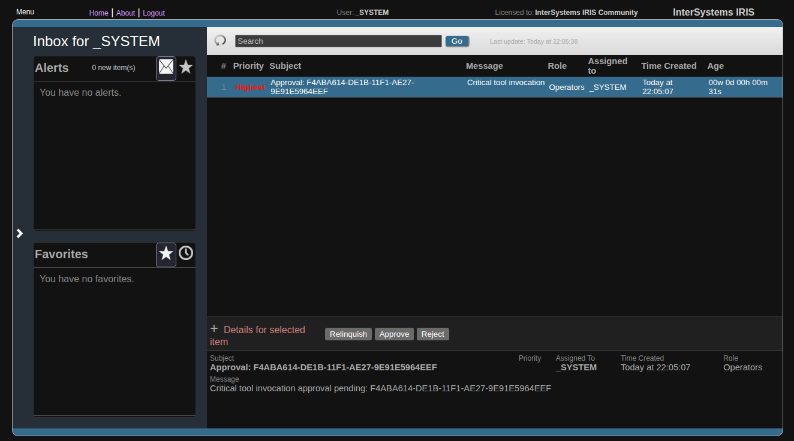

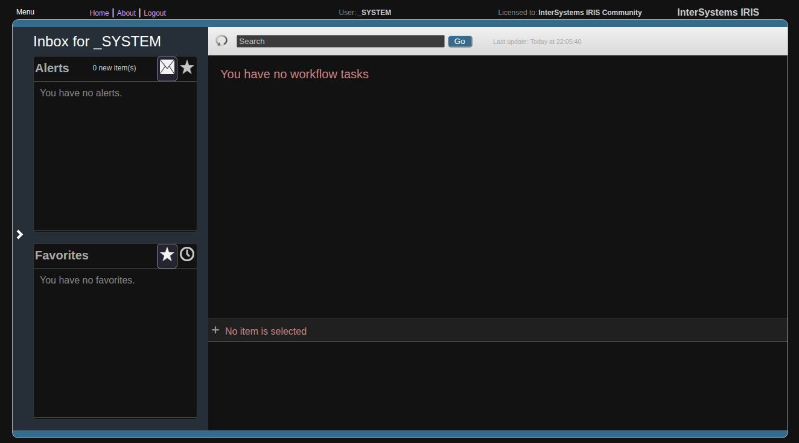

> **Why this works.** The portal dispatches `EnsLib.Workflow.Engine.%ProcessAction` → `TaskResponse.OnAction` on the task's stored class. InteropMCP provides `br.musketeers.InteropMCP.WorkflowTaskResponse`, whose `OnAction` records the decision in `br.musketeers.InteropMCP.Approvals` and closes the task locally — no deferred response is needed because the approval request was created outside a production message flow.

**Step 7c. Verify the invocation was rejected**

```
Use the GetInvocationStatus tool with invocationId "<INVOCATION_ID>"
```

After rejection the status should be `"rejected"` and no message reached the production.

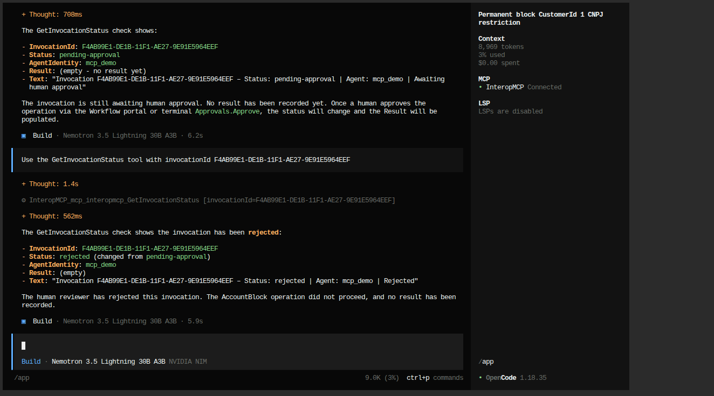

Every decision is written to the gateway audit log (`br.musketeers.InteropMCP.Log`) and to the `br_musketeers_InteropMCP.Approvals` table.

> **Fallback (headless operator).** If the operator works only through the terminal, the same decision can be recorded without the portal:
> ```
> Do ##class(br.musketeers.InteropMCP.Approvals).Reject(ApprovalId, "operator1", "policy violation")
> ```


### Step 8: Configure agent to auto-create workflow tasks for restricted CNPJ risk checks

In the previous step, a workflow task for approvement was issued automatically by a critical tool in InteropMCP. Now, let's show the decision on restrict access to non critical tools could be delegated to the agent, using the CreateWorkflowTask tool.

In this example we'll use a hipothetical restrict CNPJ list store into a file to instruct an opencode agent to check it before calling any Risk Check analysis. In the `opencode.json` file, create a new key like this (note: this is already defined in the demo app repository)

```json
  "agent": {
    "build": {
      "prompt": "You are operating the InteropMCP gateway. Before calling the RiskCheck tool for any CNPJ:\n\n1. Read config/restricted_cnpjs.txt to get the current restricted CNPJ list.\n2. If the CNPJ is in the restricted list:\n   - Call MetaTools.CreateWorkflowTask(toolName=\"RiskCheck\", pParams='{\"Cnpj\": \"<cnpj>\"}', pReason=\"CNPJ is restricted - requires human approval before risk assessment\").\n   - Return _status: \"held\" pending human approval.\n3. If the CNPJ is NOT restricted:\n   - Call RiskCheck(Cnpj=\"<cnpj>\") directly.\n   - Return the result.\n\nNever hardcode CNPJ values — always read from config/restricted_cnpjs.txt."
    }
  },
```

This list is just a text file, like this:

```plain
12.345.678/0001-90
98.765.432/0001-10
11.222.333/0001-44
```

Now, issue a prompt like this, with a non-restricted code:

```
Check the risk for Cnpj 99.999.999/0001-90 with full scope
```

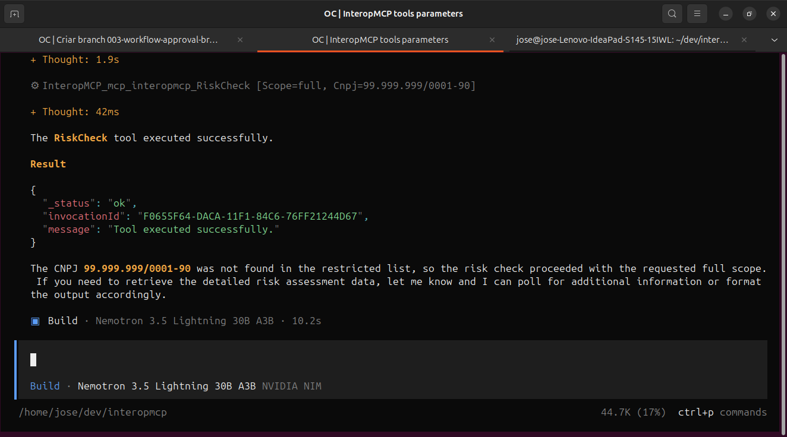

As this code isn't in the restricted list, you should be able to see a corresponding request in the Production:

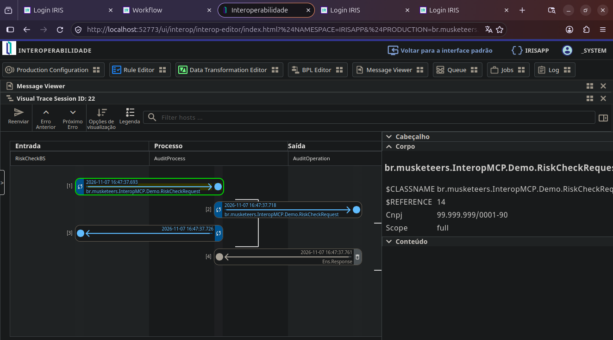

Now, issue a prompt using a restricted code:

```
Check the risk for Cnpj 12.345.678/0001-90 with full scope
```

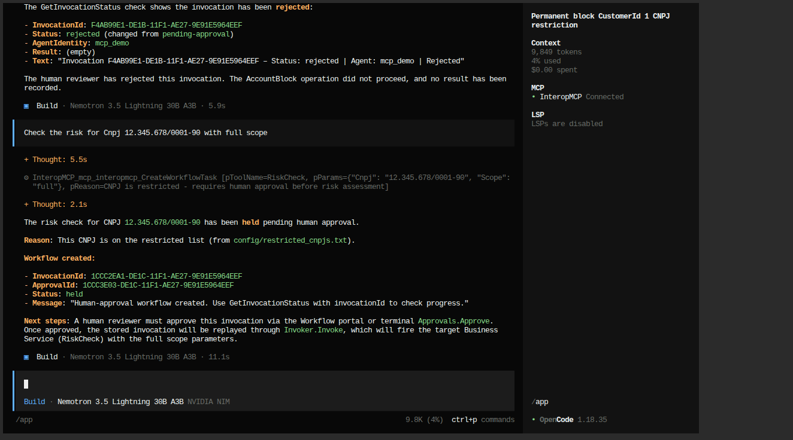

Now, you have a new workflow task requesting an approval to invoke the Production Business Service:


Approve it in the User Portal: select the task, click **Accept** to take ownership, then click **Approve**. The approval is recorded, the task leaves the inbox, and the gated invocation is released — the `RiskCheck` Business Service runs through the normal production flow.


The corresponding `RiskCheck` message now appears in the IRIS Interoperability production:

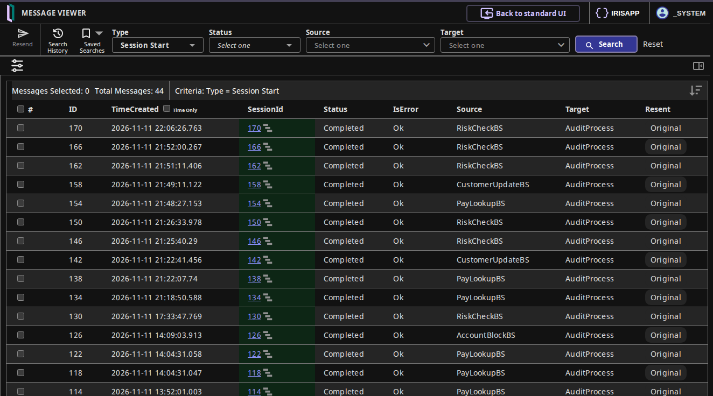

And the invocation status becomes `"completed"`:

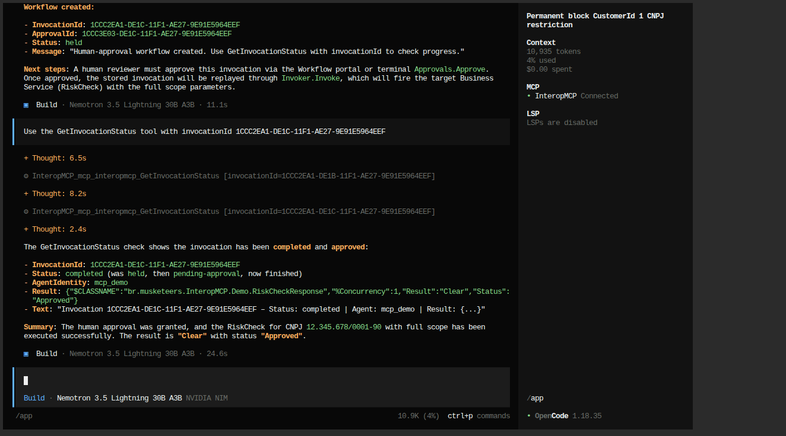

## 5. What this means

InteropMCP lets AI agents talk to your existing InterSystems IRIS integrations without rewriting them, while keeping authentication, per-tool guardrails, and dual-plane auditability. Human operators complete critical calls from the IRIS User Portal Workflow inbox (Accept → Approve/Reject), and every decision is recorded in the gateway's audit store. The next article covers the security and authentication model in depth.

---
*This article was drafted with AI assistance and reviewed by the author.*

**Repository:** `src/br/musketeers.InteropMCP/` — see `Setup.cls`, `Registry.cls`, `Guardrails.cls`, `Invoker.cls`, `GeneratedTools.cls` and `docs/interop-mcp/architecture.md`.
