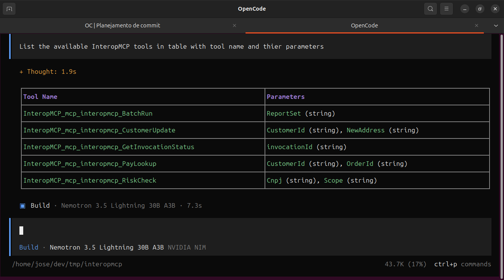
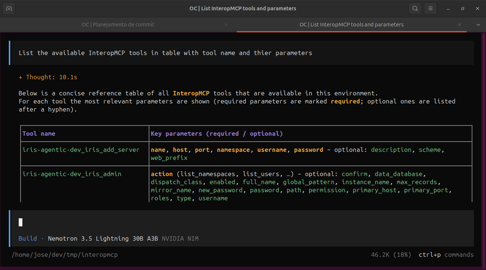
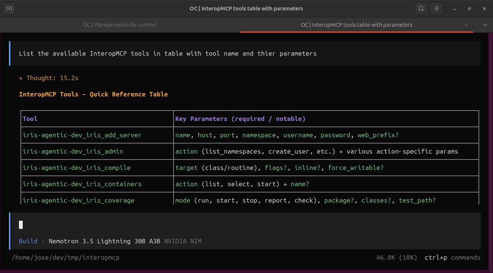
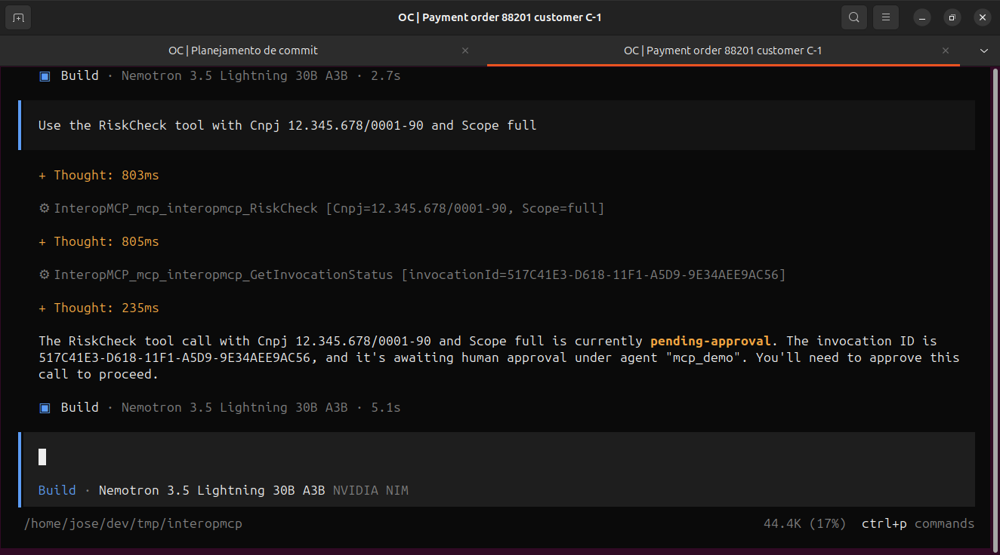
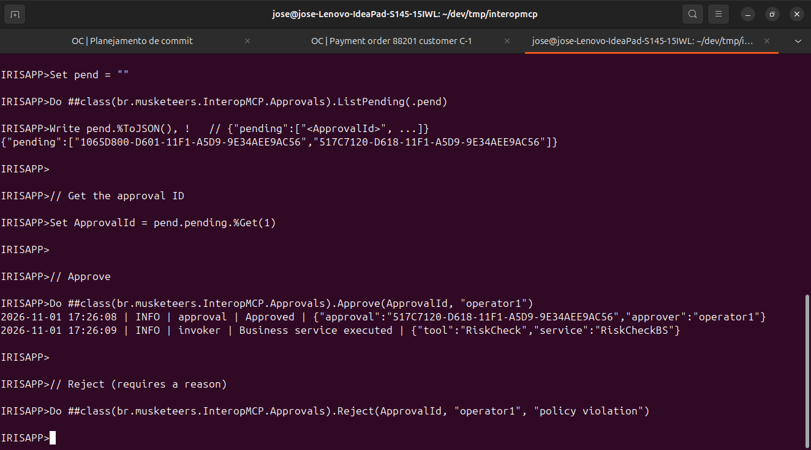
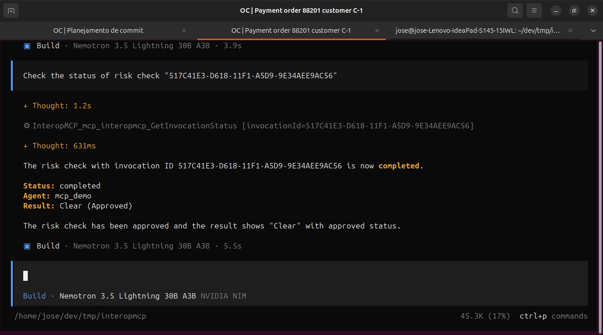

# InteropMCP security and authentication: who can call your MCP tools

**Executive summary**

- The MCP endpoint `/mcp/interopmcp` runs in **secured mode only**: platform authentication (`AutheEnabled=32`), no anonymous traffic.
- Callers need a valid IRIS user and the `:InteropMCPRoles` role (resource `InteropMCP_Access`).
- Per-tool guardrails: `readonly` executes immediately; `write` requires an authorized caller; `critical` never executes without a recorded human approval.
- Every decision (allowed, denied, approved, rejected) is logged by the gateway and by platform audit events (`AuthenticationDenied`, `AccessDenied`).

---

## 1. Authentication model

InteropMCP is published as an IRIS web application of type 18 (served by the IRIS private web server, not the Apache CSP Gateway):

| Property | Value |
|----------|-------|
| Path | `/mcp/interopmcp` |
| Dispatch class | `br.musketeers.InteropMCP.MCPService` (`%AI.MCP.Service`) |
| Type | 18 |
| Authentication | `AutheEnabled = 32` (platform / password) |
| Target namespace | `IRISAPP` |
| MatchRoles | (empty) |

The endpoint is provisioned idempotently by `br.musketeers.InteropMCP.Setup.ProvisionApplication()`. With `AutheEnabled = 32`, any HTTP request without a valid credential is rejected with `401 Unauthorized` before reaching the MCP service. The `iris-mcp-server` bridge (port 8080) forwards the caller's `Authorization` header to IRIS through the superserver (port 1972).

### Validate with Opencode

**With valid credentials**

```bash
export INTEROPMCP_BASIC="Basic $(printf 'mcp_demo:change-me' | base64 -w0)"
opencode
```

The MCP Servers panel shows `InteropMCP ✓ connected`. Listing tools returns the correct list:

`List the available InteropMCP tools in table with tool name and thier parameters`



**Without credentials / invalid token**

```bash
unset INTEROPMCP_BASIC
# or use a wrong user, e.g.
# export INTEROPMCP_BASIC="Basic $(printf 'bad:user' | base64 -w0)"
opencode
```

The panel still shows `InteropMCP ✓ connected`. Authentication problems are not surfaced directly in the server panel. The only indirect evidence is when listing tools: the agent hallucinates an incorrect tool list instead of reporting a clear 401 error.



### Validate with Raw HTTP validation

#### 401 without credentials
```bash
curl -s -o /dev/null -w "%{http_code}" -X POST http://localhost:8080/mcp \
  -H "Content-Type: application/json" \
  -d '{"jsonrpc":"2.0","id":1,"method":"initialize","params":{}}'
# Expected: 401
```

#### 200 with valid Basic auth
```bash
export INTEROPMCP_BASIC="Basic $(printf 'mcp_demo:change-me' | base64 -w0)"
curl -s -o /dev/null -w "%{http_code}" -X POST http://localhost:8080/mcp \
  -H "Content-Type: application/json" \
  -H "Accept: application/json, text/event-stream" \
  -H "Authorization: $INTEROPMCP_BASIC" \
  -d '{"jsonrpc":"2.0","id":1,"method":"initialize","params":{"protocolVersion":"2024-11-05","capabilities":{},"clientInfo": {"name":"conformance","version":"1"}}}' 
# Expected: 200
```

## 2. Resource, role, and least-privilege grants

The setup creates (or reconciles) security objects in `%SYS`:

| Object | Name | Purpose |
|--------|------|---------|
| Resource | `InteropMCP_Access` | Gates access to the MCP endpoint |
| Role | `InteropMCPRoles` | Least-privilege role for MCP callers |

The role carries these minimum grants (`RoleResources`):

```
InteropMCP_Access:U,
%DB_IRISAPP_CODE:R,
%DB_IRISAPP_DATA:RW,
%DB_IRISLIB:R,
%DB_IRISTEMP:RW,
%Service_SQL:U
```

- `U` = use (connect), `R` = read, `RW` = read/write.
- The role also receives `GRANT SELECT` on the gateway's own tables (`Invocations`, `Approvals`) via `EnsureSqlPrivileges()`, because database-level grants alone do not confer SQL table privileges.

### Validate with Opencode

Switch `INTEROPMCP_BASIC` to user `mcp_demo2` which has no role:
```bash
export INTEROPMCP_BASIC="Basic $(printf 'mcp_demo2:change-me' | base64 -w0)"
opencode
```

Opencode still reports `InteropMCP ✓ connected`. Role enforcement is not shown directly in the server panel. Evidence is indirect: asking to list tools results in hallucination / an empty/incorrect list, and tool calls cannot be executed. With `mcp_demo2` no tool can be used, confirming role enforcement.



### Validate with Raw HTTP validation

Role enforcement can be observed via `tools/list`. With a user without `InteropMCPRoles` the list is empty; with an entitled user the tools array is returned. This matches the Opencode behavior described above.

```bash
export INTEROPMCP_BASIC2="Basic $(printf 'mcp_demo2:change-me' | base64 -w0)"
export HEADER_FILE=$(mktemp)

# Enviando initialize (com o redirecionamento corrigido na mesma linha)
curl -s -D "$HEADER_FILE" -X POST http://localhost:8080/mcp \
  -H "Content-Type: application/json" \
  -H "Accept: application/json, text/event-stream" \
  -H "Authorization: $INTEROPMCP_BASIC2" \
  -d '{"jsonrpc":"2.0","id":1,"method":"initialize","params":{"protocolVersion":"2024-11-05","capabilities":{},"clientInfo":{"name":"shell-client","version":"1"}}}' > /dev/null

# Extrai o mcp-session-id dos headers salvos (case-insensitive)
export SESSION_ID=$(grep -i "mcp-session-id:" "$HEADER_FILE" | tr -d '\r' | awk '{print $2}' | tr -d '\r')
rm -f "$HEADER_FILE"

# Buscando tools/list
echo "--------------------------------------------------------------------------------"
export RESPONSE=$(curl -s -X POST http://localhost:8080/mcp \
  -H "Content-Type: application/json" \
  -H "Accept: application/json, text/event-stream" \
  -H "Authorization: $INTEROPMCP_BASIC2" \
  -H "Mcp-Session-Id: $SESSION_ID" \
  -d '{"jsonrpc":"2.0","id":2,"method":"tools/list","params":{}}')

echo "Tools:"
echo "$RESPONSE" | grep '^data: {' | sed 's/^data: //' | jq '.result.tools'
```

> With `mcp_demo2` the result is an empty list:
```bash
Tools: []
```

```bash
export INTEROPMCP_BASIC2="Basic $(printf 'mcp_demo:change-me' | base64 -w0)"
export HEADER_FILE=$(mktemp)

# Enviando initialize (com o redirecionamento corrigido na mesma linha)
curl -s -D "$HEADER_FILE" -X POST http://localhost:8080/mcp \
  -H "Content-Type: application/json" \
  -H "Accept: application/json, text/event-stream" \
  -H "Authorization: $INTEROPMCP_BASIC2" \
  -d '{"jsonrpc":"2.0","id":1,"method":"initialize","params":{"protocolVersion":"2024-11-05","capabilities":{},"clientInfo":{"name":"shell-client","version":"1"}}}' > /dev/null

# Extrai o mcp-session-id dos headers salvos (case-insensitive)
export SESSION_ID=$(grep -i "mcp-session-id:" "$HEADER_FILE" | tr -d '\r' | awk '{print $2}' | tr -d '\r')
rm -f "$HEADER_FILE"

# Buscando tools/list
echo "--------------------------------------------------------------------------------"
export RESPONSE=$(curl -s -X POST http://localhost:8080/mcp \
  -H "Content-Type: application/json" \
  -H "Accept: application/json, text/event-stream" \
  -H "Authorization: $INTEROPMCP_BASIC2" \
  -H "Mcp-Session-Id: $SESSION_ID" \
  -d '{"jsonrpc":"2.0","id":2,"method":"tools/list","params":{}}')

echo "Tools:"
echo "$RESPONSE" | grep '^data: {' | sed 's/^data: //' | jq '.result.tools'
```

> With `mcp_demo` the result is a populated array:
```bash
Tools: [...]
```

## 3. Caller identity

In secured mode the CSP application has already authenticated the caller, so the gateway attributes each invocation to `$USERNAME`:

```objectscript
ClassMethod CurrentAgent() As %String
{
    If ##class(br.musketeers.InteropMCP.Setup).GetMode() = "demo" Quit "local-dev"
    Set user = $USERNAME
    If (user = "") || (user = "UnknownUser") Quit "local-dev"
    Quit user
}
```

- Real IRIS user → identity stored with every invocation (`AgentIdentity` in `br_musketeers_InteropMCP.Invocations`).
- Empty or `UnknownUser` → marker `local-dev` (development/localhost-only containers).

## 4. Demo users

The container bootstrap (`br.musketeers.InteropMCP.Demo.Setup.EnsureDemoUsers`) creates two users from `INTEROPMCP_DEMO_PASSWORD` (default `change-me`):

| User | Role | Can call MCP tools? |
|------|------|---------------------|
| `mcp_demo` | `InteropMCPRoles` | Yes (entitled) |
| `mcp_demo2` | (none) | No — `403` |

## 5. Per-tool guardrails

Authentication opens the door; each tool's classification decides what happens next. The classification comes from the Business Service class parameter `AIGATEWAY` and is enforced by `br.musketeers.InteropMCP.Guardrails.Check` before any Business Service is fired:

| Classification | Behavior | Demo example |
|---------------|----------|--------------|
| `readonly` | Immediate execution, no extra authorization | `PayLookupBS` — check payment |
| `write` | Authorized caller, decision logged | `CustomerUpdateBS` — update address |
| `critical` | No execution: creates `pending-approval` invocation + approval request; runs only after `Approvals.Approve(id, approver)` | `RiskCheckBS` — risk assessment |

### Validate with Opencode

`readonly` — executes immediately

`Use the PayLookup tool with OrderId 88201 and CustomerId C-1`

Expected: `isError:false`, text `"1"` (completed)

`write` — executes for authorized caller

`Use the CustomerUpdate tool with CustomerId 1 and NewAddress "Av. Paulista, 1000"`

Expected: `isError:false`, text `"1"` (completed)

`critical` — held for approval, Business Service never runs on the agent's call

`Use the RiskCheck tool with Cnpj 12.345.678/0001-90 and Scope full`

Expected: `isError:false`, text `"1"`, but status is `pending-approval` (not executed)



## 6. Human-in-the-loop approval for critical tools

Critical calls are parked in `pending-approval`. An operator lists pending approvals and approves or rejects:

```bash
docker exec -it ai-hub-dev-template-iris-1 iris session iris -U IRISAPP
```

```objectscript
// List pending approvals
Set pend = ""
Do ##class(br.musketeers.InteropMCP.Approvals).ListPending(.pend)
Write pend.%ToJSON(), !   // {"pending":["<ApprovalId>", ...]}

// Get the approval ID
Set ApprovalId = pend.pending.%Get(1)

// Approve
Do ##class(br.musketeers.InteropMCP.Approvals).Approve(ApprovalId, "operator1")

// Reject (requires a reason)
Do ##class(br.musketeers.InteropMCP.Approvals).Reject(ApprovalId, "operator1", "policy violation")
```



There is no automatic expiry: pending items remain until decided or explicitly cancelled. Every decision is written to `br_musketeers_InteropMCP.Approvals` and to the gateway log (`br.musketeers.InteropMCP.Log`, component `approval`).

### Validate: query pending approvals via SQL

```sql
SELECT ApprovalId, InvocationId, Decision, Approver, DecidedAt, Reason
FROM br_musketeers_InteropMCP.Approvals;
```

Example row from a validated call:

| ApprovalId | InvocationId | Decision | Approver | DecidedAt | Reason |
| :--- | :--- | :--- | :--- | :--- | :--- |
| BFC822EB-D56D-11F1-A5D9-9E34AEE9AC56 | BFC7AFB8-D56D-11F1-A5D9-9E34AEE9AC56 | approved | operator1 | 2026-10-31 21:09:45 | |
| 1065D800-D601-11F1-A5D9-9E34AEE9AC56 | 1065AF61-D601-11F1-A5D9-9E34AEE9AC56 | pending | | | |
| 517C7120-D618-11F1-A5D9-9E34AEE9AC56 | 517C41E3-D618-11F1-A5D9-9E34AEE9AC56 | approved | operator1 | 2026-11-01 17:26:08 | |


### Validate: query pending approvals via Opencode

`Check the status of risk check "<InvocationId>"`



## 7. Platform audit events

Secured mode requires platform auditing enabled in the IRIS Management Portal, System Administration > Security > Auditing. The setup provisions the `INTEROPMCP` event type with two events:

- `AuthenticationDenied` — authentication rejected at the endpoint.
- `AccessDenied` — entitlement/role denial (e.g. user lacks `InteropMCPRoles`).

Security-relevant events (denied calls, rejected authorizations, approval decisions) are also written by `br.musketeers.InteropMCP.Log` at `warn`/`error` levels to the console and to the persistent global `^InteropMCP.LogD`.

## 8. Two separate audit planes

By design, the gateway and the production keep independent audit trails:

| Plane | Storage | Written by | Purpose |
|-------|---------|------------|---------|
| Production-native | `Ens.MessageHeader`, message store, Visual Trace, `^InteropMCP.Demo.AuditD` | The production components (BS → BP → BO) | Corporate audit of what the integration executed |
| Gateway | `br_musketeers_InteropMCP.Invocations`, `Approvals`, `^InteropMCP.LogD` | The gateway code | Tool-call lifecycle: agent identity, parameters, guardrail decisions, approvals |

The gateway never writes into production structures — it only fires Business Services via `CreateBusinessService` + `ProcessInput`.

### Validate: view gateway invocations

```sql
SELECT InvocationId, ToolName, AgentIdentity, Status, StartedAt, EndedAt
FROM br_musketeers_InteropMCP.Invocations ORDER BY StartedAt DESC;
```

Example row from a validated call:

| InvocationId | ToolName | AgentIdentity | Status |
|--------------|----------|---------------|--------|
| `B7805121-…` | `CustomerUpdate` | `mcp_demo` | `completed` |

And a pending critical approval:

| ApprovalId | InvocationId | Decision | Approver |
|------------|--------------|----------|----------|
| `62ADC228-…` | `62AD9123-…` | `pending` | (none) |

## 9. Secure deployment checklist

1. Enable platform auditing in the IRIS Management Portal, System Administration > Security > Auditing.
2. Provision the endpoint: `Do ##class(br.musketeers.InteropMCP.Setup).Run("prod")`.
3. Create callers with role `InteropMCPRoles`; create unentitled users for negative testing.
4. Verify `401` without credentials and `403` for users without the role.
5. Classify each Business Service (`readonly` / `write` / `critical`) by operational risk.
6. Designate operators who will run `Approvals.Approve` / `Reject` for critical tools.
7. Monitor `br_musketeers_InteropMCP.Invocations` and `Approvals` plus `^InteropMCP.LogD`.

---

InteropMCP's security is layered: endpoint authentication, least-privilege role, per-tool guardrails, and dual-plane audit — so you can expose existing IRIS integrations to AI agents without surrendering control over who executes what.

---
*This article was drafted with AI assistance and reviewed by the author.*

**Repository:** `src/br/musketeers.InteropMCP/Setup.cls`, `Guardrails.cls`, `Invoker.cls`, `Approvals.cls`, `Log.cls` and `docs/interop-mcp/architecture.md`.
