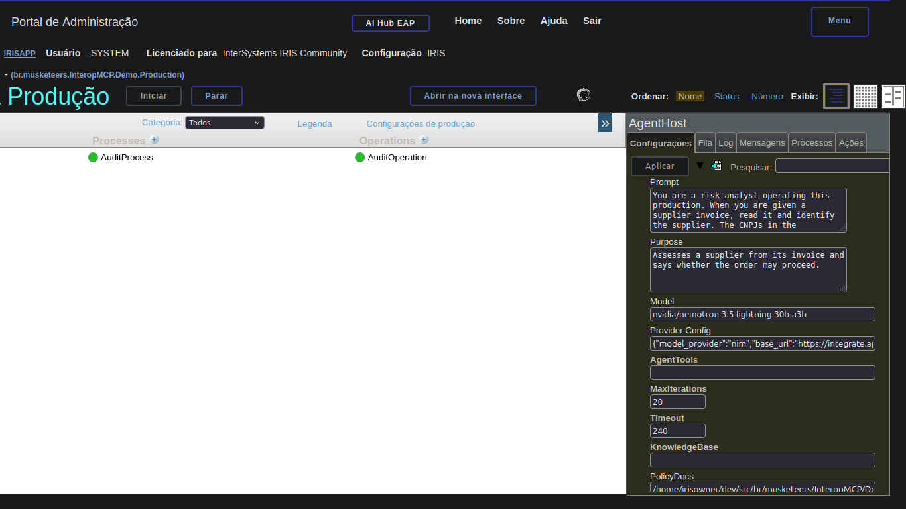
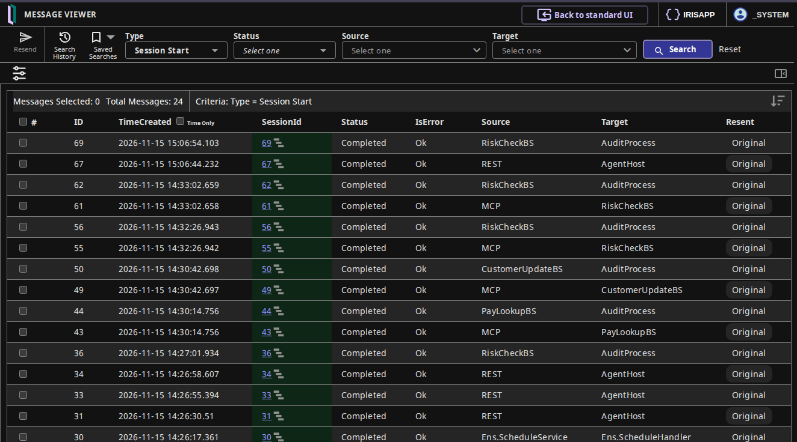
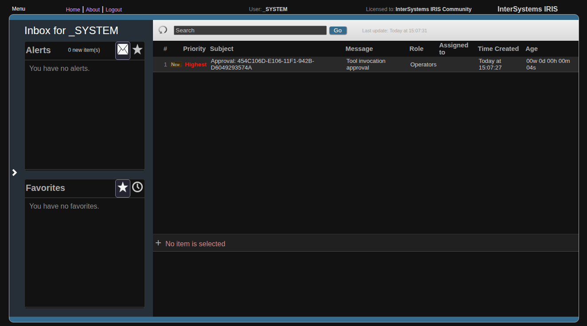
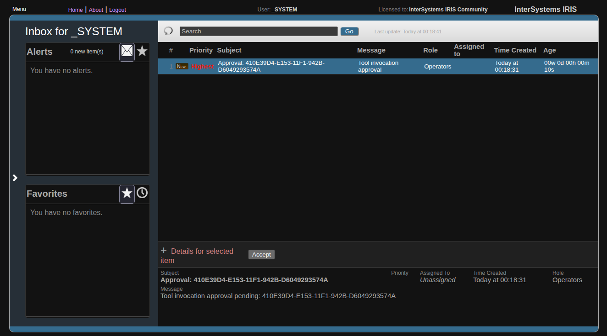
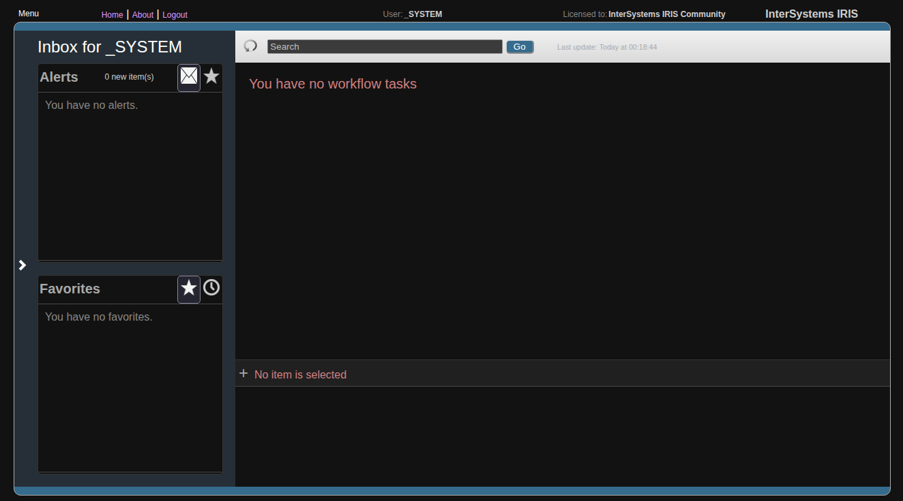
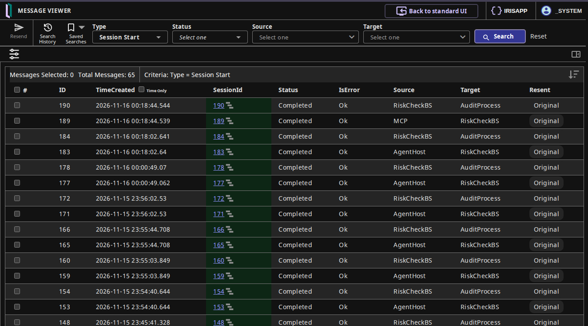

# InteropMCP: run your agent directly in the InterSystems IRIS production via adapter

**TL;DR**

- The IRIS agent now lives inside the Interoperability Production, exposed through a custom inbound adapter (`br.musketeers.InteropMCP.Agent.Adapter`).
- The production item **is** the agent: it is reached through the same AI HUB / MCP gateway path as every other tool, with no bespoke endpoint to write — the demo's REST service exists only so an external caller can trigger it.
- The adapter is a **polling** inbound adapter: the REST producer enqueues the request in a global queue and answers `202 Accepted`; the adapter picks the work item up inside the production and runs the agent there. The MCP path stays push — calling the agent tool over MCP runs it immediately, with no queue in between.
- Built on the InterSystems **AI HUB** framework in ObjectScript: the custom adapter carries the SystemPrompt, the AgentTools scope, the production's own parameters, the timeout, and the model provider settings. Section 4 inventories every AI HUB class InteropMCP extends or depends on.
- The adapter is **production-agnostic**: any Business Service annotated with `AIGATEWAY` / `AIGATEWAYDESC` / `REQUESTCLASS` becomes an AI tool automatically — the registry discovers them and generates `GeneratedTools`.
- The agent reads the records its own production names — the restricted list, in this demo — with a file reading tool, and decides for itself which tools to call: run the risk assessment, or ask a human first.
- Per-tool security classification (`readonly` / `write` / `critical`) and human-in-the-loop approval (`CreateWorkflowTask` → `Approvals.Approve`) govern every agent action; the approval is a native IRIS Workflow task, decided in the User Portal.
- The hands-on below calls the agent over REST with a supplier invoice and reproduces both outcomes end to end on the test stack (REST 52775 / MCP 8083), following the request from the `202 Accepted` to the final answer.

## Contents

- [1. Completing the first article](#1-completing-the-first-article)
- [2. The idea: the agent as a production item](#2-the-idea-the-agent-as-a-production-item)
- [3. AI HUB: custom adapter configuration (prompt, tools, timeout)](#3-ai-hub-custom-adapter-configuration-prompt-tools-timeout)
  - [The agent's document, in full](#the-agents-document-in-full)
- [4. The AI HUB classes InteropMCP builds on](#4-the-ai-hub-classes-interopmcp-builds-on)
- [5. Custom adapter for any production](#5-custom-adapter-for-any-production)
- [6. Hands-on: call the agent over REST](#6-hands-on-call-the-agent-over-rest)
  - [Prerequisites](#prerequisites)
  - [Step 1: a PDF whose CNPJ is not on the restricted list](#step-1-a-pdf-whose-cnpj-is-not-on-the-restricted-list)
  - [Step 2: a PDF whose CNPJ is on the restricted list](#step-2-a-pdf-whose-cnpj-is-on-the-restricted-list)
  - [Step 3: approving the request in the User Portal](#step-3-approving-the-request-in-the-user-portal)
- [7. What this means](#7-what-this-means)

---

## 1. Completing the first article

The first article introduced the InteropMCP gateway: it exposes InterSystems IRIS Interoperability Production Business Services as native Model Context Protocol (MCP) tools, invoked through `CreateBusinessService` + `ProcessInput`, preserving native traceability (`Ens.MessageHeader`, Visual Trace). It also introduced per-tool security classification (`readonly` / `write` / `critical`) and human-in-the-loop approval.

This third article completes that picture. The agent no longer lives outside the production calling in through a separate REST service. Instead, **the agent runs directly inside the production**, exposed by a custom inbound adapter (`br.musketeers.InteropMCP.Agent.Adapter`). You write the agent once, configure it through the adapter's settings (SystemPrompt, AgentTools scope, timeout, model provider), and any production can host it — with zero changes to the production's existing Business Services.

The hands-on in section 6 calls that agent over REST with a supplier invoice and shows both outcomes: the assessment running on its own, and the assessment waiting for a human.

## 2. The idea: the agent as a production item

InteropMCP flips the model again. Instead of an external agent calling production services, the production itself hosts the agent:

1. A production item of adapter class `br.musketeers.InteropMCP.Agent.Adapter` is added to the production.
2. The registry (`br.musketeers.InteropMCP.Registry`) discovers it and publishes an **agent entry** in the MCP tool catalog.
3. An AI agent calls the agent tool by natural language (e.g. *"assess the risk of supplier with CNPJ 12.345.678/0001-90"*).
4. The agent's business host (`br.musketeers.InteropMCP.Agent.Host`) runs the reasoning loop inside the production, using the same guardrail, invocation, and approval path as every other tool.
5. When the agent invokes a capability (e.g. `RiskCheck`), the call goes through `Guardrails.Check` and `Invoker.Invoke` to the target Business Service — creating `Ens.MessageHeader` rows and a Visual Trace exactly as before.

Removing the adapter changes nothing about the production itself (zero-regression requirement).

### Two doors, one agent

The same production item answers two very different callers, and the difference is worth spelling out because it is a design decision, not an accident:

| | MCP tool call | REST call |
|---|---|---|
| Shape | **push** — the call runs the agent in the caller's thread | **pull** — the request is queued, the adapter picks it up |
| Who executes | the MCP request thread, inside the same production | the adapter's own task, on its own schedule |
| Latency | the caller waits for the answer | the caller gets `202 Accepted` and polls |
| Why | a tool call is a conversation turn: the caller is waiting for the answer | an external HTTP client cannot hold a production task open for minutes |

The MCP path stays as it was: `CreateBusinessService` + `ProcessInput`, straight into the agent's business host. The REST path is the one that goes through the queue, because an HTTP request has a deadline and an agent run does not. The queue is a global (`^InteropMCP.PromptQueue`), the adapter polls it once a second, and each work item carries the goal, the extracted document text, and the invocation id that ties the run back to the caller's poll.

The diagram uses the **demo production** (`br.musketeers.InteropMCP.Demo.Production`) as a concrete example. This demo production exposes five Business Services — `PayLookupBS`, `CustomerUpdateBS`, `RiskCheckBS`, `AccountBlockBS`, and `BatchRunBS` — each annotated for AI exposure via class parameters (`AIGATEWAY`, `AIGATEWAYDESC`, `REQUESTCLASS`), plus an `AuditProcess` Business Process and `AuditOperation` Business Operation that provide native traceability.

InteropMCP itself is **production-agnostic**: it is not tied to the demo and works with any InterSystems IRIS Interoperability Production whose Business Services carry the same annotations. The demo is used only to make the flow easier to understand; you can replace it with your own production and re-run `br.musketeers.InteropMCP.Registry.BuildCatalog` to generate the corresponding tools.

## 3. AI HUB: custom adapter configuration (prompt, tools, timeout)

The core of the AI HUB integration lives in the **custom adapter** `br.musketeers.InteropMCP.Agent.Adapter`. It carries the configurations that define the agent's behavior and which tools it can reach:

| Setting | Purpose |
|---------|---------|
| **SystemPrompt** | The agent's instructions. The adapter loads policy documents (e.g. `Demo/Policies/*.md`) and injects them into the prompt, so business rules (risk policy, restricted companies list, approval deadlines) travel with the agent without code changes. |
| **AgentTools** | The scope of capabilities the agent may invoke. Empty means "all published capabilities"; otherwise it restricts to the named list, so the same adapter can serve agents with different permissions. |
| **ProductionConfig** | The production's own parameters, as a JSON object: the files its rules name, the records its agent must consult, the CNPJs to ignore. The gateway carries them into the agent's instructions and does not interpret the keys — they belong to the production. |
| **Timeout** | How long the agent's reasoning loop may run (default 240s). |
| **Model provider** | The AI provider and model used for reasoning, configured through the adapter's `ProviderConfig` setting. |
| **PoolSize / CallInterval / LeaseSeconds** | How the adapter drains the work queue: how many runs may execute at once (the demo uses `1`, serializing them), how often it looks for new work (`1` second), and how long a claimed item may stay claimed before the adapter treats it as abandoned (`300` seconds) and reaps it. |

These settings live on the production item and are read by the adapter at runtime — no code to touch when adjusting agent behavior. Just change the adapter's parameters and the agent picks them up on the next run.

The Management Portal is where you edit them. On the demo production, the settings panel of the `AgentHost` item is the agent's whole configuration — its document, its model and provider, its effort and time bounds, and the paths it reads:



### The agent's document, in full

The `Prompt` setting is the agent's document — the rules it reasons under, in plain language. Here is the demo's, exactly as stored (line breaks added for readability):

```text
You are a risk analyst operating this production. When you are given a supplier invoice, read it and identify the supplier.

The CNPJs in the ignoredCnpjs entry of the production configuration below are this company's own: they are never suppliers to assess, so ignore them entirely - do not check them against the restricted list and do not assess them.

Before assessing the supplier you MUST check the restricted list, and you decide what to do with what you read:

1. Call ReadFile with the path given in the production configuration below (the restrictedCnpjsFile entry) to read the restricted list. Never rely on your own memory of the list: always read the file.
2. Compare the supplier's CNPJ with the CNPJs in the list you read.
3. If the supplier's CNPJ is on the list, do NOT run the risk assessment: call CreateWorkflowTask with toolName="RiskCheck", pParams={"Cnpj":"<cnpj>"} and pReason="CNPJ is restricted - requires human approval before risk assessment", then report that the request is pending approval.
4. If the supplier's CNPJ is not on the list, call RiskCheck with that CNPJ and assess it.

If the list cannot be read, do not assess anything: report that the restricted list is unavailable.

If the request names a supplier CNPJ that differs from the one in the document, check both and apply the stricter result.
```

The document is only the first part of what the agent receives: the adapter appends the policy documents from `PolicyDocs` and then the `ProductionConfig` JSON — the two entries the prompt refers to as *"the production configuration below"*:

```json
{
  "restrictedCnpjsFile": "restricted_cnpjs.txt",
  "ignoredCnpjs": ["44.555.666/0001-81"]
}
```

Read together, the document and this configuration encode six decisions the hands-on in section 6 then exercises:

| Phrase in the prompt | Decision encoded |
|---|---|
| `ignore them entirely` | `44.555.666/0001-81` — the demo company's own CNPJ, which every invoice names as the recipient — is never treated as a candidate supplier |
| `you decide what to do with what you read` | The branch between `RiskCheck` and `CreateWorkflowTask` is the agent's own judgment, not a rule hard-coded into the gateway |
| `always read the file` | The restricted list is read from disk at run time; nothing about it is baked into the prompt |
| `do NOT run the risk assessment` | A restricted CNPJ produces a human-approval task (`CreateWorkflowTask`) instead of an immediate `RiskCheck` |
| `do not assess anything: report that the restricted list is unavailable` | Fail-closed: if the file can't be read, nothing is assessed |
| `check both and apply the stricter result` | A CNPJ named in the request that differs from the document's is never accepted automatically |

The hands-on in section 6 runs the agent through both scenarios, and its answers show decisions 1–4 in action: the restricted list is read first (`ReadFile`), the supplier's CNPJ is compared against it (`RiskCheck` runs or doesn't), and the demo's own CNPJ is skipped (decision 1). Decisions 5–6 are the fallback rules the prompt promises: they govern calls the two scenarios don't produce.

## 4. The AI HUB classes InteropMCP builds on

The AI HUB is the substrate: it provides the protocol, the tool surface, and the agent loop. InteropMCP adds gateway semantics on top — classification, the guardrail choke point, the invocation audit store, and the approval bridge. Below is the full dependency surface.

### Classes extended from the AI HUB

| InteropMCP class | Extends | What the AI HUB provides |
|---|---|---|
| `MCPService` | `%AI.MCP.Service` | Endpoint: `SPECIFICATION`, `ToolManager`, hooks `OnAuthenticate`/`Login`/`Error`; web app Type 18 |
| `ToolSet` | `%AI.ToolSet` | XData `Definition` with `<Include Class=...>`; dispatch via `%Invoke` |
| `Agent/ToolSet` | `%AI.ToolSet` | Same contract, for the **agent** surface (separate from MCP clients) |
| `GeneratedTools` | `%AI.Tool` | Reflection discovery of ClassMethods; docstring → tool description |
| `AgentTools` | `%AI.Tool` | Same, for the agent surface |
| `MetaTools` | `%AI.Tool` | `CreateWorkflowTask` — management tool, not a capability |
| `InvocationStatusTools` | `%AI.Tool` | `GetInvocationStatus` |
| `FileTools` | `%AI.Tool` | `ReadFile` |
| `Agent/ToolAudit` | `%AI.Policy.Audit` | Audit hooks `%LogExecution` and `%LogDenial` |

### Classes used without inheritance

| Class | Used in | For what |
|---|---|---|
| `%AI.Agent` | `Agent/Builder`, `Agent/Host` | The run loop: `%Init` → `CreateSession` → `Run` |
| `%AI.Provider` | `Agent/Builder` | `.Create(name, settings)` — model + credential |
| `%AI.ToolMgr` | `Agent/Host` (via `agent.ToolManager`) | Tool registry + `SetAuditPolicy` |
| `%AI.Utils.SettingStore` | `Agent/Builder` | `Expand()` — resolves `@{env:...}` placeholders |
| `%AI.Utils.Text` | `Agent/ToolAudit` | `StripControlChars` on audit entries |

### The five classes that carry the architecture

#### `%AI.MCP.Service` — the endpoint

`SPECIFICATION` points to `br.musketeers.InteropMCP.ToolSet`; a Type 18 web application serves the path. `LoadToolSetsToManager` loads the toolsets into a `ToolManager` shared per process (`GetOrCreate`/`CommitShared`). The InteropMCP subclass overrides three hooks: `OnAuthenticate` (auth + access audit), `Login` (401 JSON, not HTML), `Error` (403 JSON). The `iris-mcp-server` binary (Rust) bridges MCP clients to this endpoint.

#### `%AI.ToolSet` and `%AI.Tool` — the tool surface

Two distinct toolsets: the MCP endpoint surface (`GeneratedTools` + `InvocationStatusTools` + `MetaTools`) and the agent surface (`AgentTools` + `MetaTools` + `FileTools`). `<Include>` declares classes; discovery is by reflection of ClassMethods. InteropMCP overrides `%Invoke` on the MCP toolset to instantiate the tool per call — the AI HUB caches the instance; a recompiled class only takes effect after the toolset is recompiled.

#### `%AI.Agent` and `%AI.Provider` — the run loop

`Builder` assembles the agent (`SystemPrompt`, `Model`, `MaxIterations`, `ToolSets`, `Provider`). `%Init` loads toolsets; `CreateSession` builds the tool schema from `ToolManager.%Discover()` and passes `max_iterations`; `Run` wraps `Chat()` — the Rust agentic loop with automatic tool execution. The `Provider` comes from `ProviderConfig` with `@{env:...}` resolved by `SettingStore`.

#### `%AI.Policy.Audit` — the audit hook

`Agent/ToolAudit` overrides the two hooks and logs every call in order; the `Host` attaches the policy to the `ToolManager` at run start. This produces the `CapabilitiesUsed` array in the response.

#### `%AI.Utils.SettingStore` — credential references

`Expand()` resolves `@{env:...}` / `@{wallet:...}` / `@{config:...}` placeholders so secrets never appear in the configuration.

### The boundary: what is NOT AI HUB

The AI HUB provides the substrate — protocol, tool surface, agent loop, audit hooks, credential resolution. InteropMCP adds the **gateway layer**: `Registry` (discovery + code-gen), `Guardrails` (classification + choke point), `Invoker` (invocation + header audit), `Invocations` (store + status), `Approvals` (store + decision), `WorkflowBridge` (native IRIS task), `HeaderAudit` (message headers + session). The AI HUB gives the substrate; InteropMCP adds the governance.

## 5. Custom adapter for any production

The `Registry` is deliberately **production-agnostic**: it scans enabled items from any production, reads class parameters `AIGATEWAY`, `AIGATEWAYDESC`, `AIGATEWAYASYNC`, and `REQUESTCLASS` from each Business Service, and dynamically generates the `GeneratedTools` class — one typed ClassMethod per capability. Each method calls `Guardrails.Check` and, if released, `Invoker.Invoke`, which fires the corresponding Business Service via `Ens.Director.CreateBusinessService + ProcessInput`.

As a result:

- **Any Business Service** from any production becomes an AI tool simply by adding the `AIGATEWAY` parameter.
- Classification (`readonly`, `write`, `critical`) defines whether execution is immediate, authorized, or awaits human approval — without changing the service code.
- `MetaTools.CreateWorkflowTask` allows creating an approval flow for any tool execution, regardless of the target service's classification.
- Request/response headers (Option B2) are generated for each call, with a shared `SessionId` between the agent and its chained calls, visible in the Visual Trace and Message Viewer.

The same custom adapter class (`br.musketeers.InteropMCP.Agent.Adapter`) works for any production. You do not write a new adapter per production — you configure the same adapter differently (different SystemPrompt, different AgentTools scope, different timeout) and deploy it into whichever production needs an agent.

## 6. Hands-on: call the agent over REST

### Prerequisites

- The InteropMCP test container is up and healthy.
- Demo credential: user `mcp_demo` / password `change-me`.
- Invoice fixtures: `src/br/musketeers/InteropMCP/Demo/Invoices/INV-2026-119.pdf` (supplier **not** restricted) and `INV-2026-120.pdf` (supplier restricted). Both carry the demo company's own CNPJ as the invoice recipient — the agent ignores it, as the production's `ignoredCnpjs` entry says.
- The production's `AgentHost` item must be enabled and running: it is the adapter that drains the queue. If it is stopped, the `POST` still answers `202` and the status stays `pending` forever.

The whole flow is scripted in `demo-web/`: `assess-pdf.sh` posts a PDF and polls until the run ends; `test-api.sh` walks the whole contract (auth, validation errors, enqueue, status, final state, and the MCP tool list). The commands below are the same calls, by hand.

### Step 1: a PDF whose CNPJ is not on the restricted list

The PDF travels Base64-encoded in the request body; the endpoint extracts its text before the agent starts — and then queues the run.

```bash
PDF=src/br/musketeers/InteropMCP/Demo/Invoices/INV-2026-119.pdf
b64=$(base64 -w0 "$PDF")
curl -s -X POST http://localhost:52775/api/agent/assess \
  -u mcp_demo:change-me \
  -H 'Content-Type: application/json' \
  -d "{\"Goal\":\"Evaluate the supplier of the attached document\",\"DocumentBase64\":\"${b64}\"}"
```

The response is HTTP **202 Accepted** — the request was accepted, not answered:

```json
{
  "status": "PENDING",
  "invocationId": "BE099310-E150-11F1-942B-D6049293574A",
  "queueId": 12,
  "message": "The run was queued. Poll GET /api/agent/status?invocationId=BE099310-E150-11F1-942B-D6049293574A for the outcome."
}
```

`queueId` is the work item's number in the global queue (`^InteropMCP.PromptQueue`); `invocationId` is the row the whole run is audited under. From here on the agent runs **inside the production**: the adapter's own task polls the queue once a second, claims the item, and calls the agent's business host.

The caller polls the status endpoint:

```bash
curl -s "http://localhost:52775/api/agent/status?invocationId=BE099310-E150-11F1-942B-D6049293574A" \
  -u mcp_demo:change-me
```

which answers with one word — `pending` while the item waits in the queue, `running` once the agent has it, and a terminal state when the run ends:

```json
{
  "Status": "running",
  "InvocationId": "BE099310-E150-11F1-942B-D6049293574A",
  "Answer": "",
  "CapabilitiesUsed": [],
  "Retrievals": []
}
```

And when the run completes, the same endpoint returns the outcome and the full trail of what the agent did:

```json
{
  "Status": "completed",
  "InvocationId": "BE099310-E150-11F1-942B-D6049293574A",
  "Answer": "**Supplier Assessment Result** - Supplier identified from the document: `DORIO TRANSPORTE E LOGISTICA LTDA` - CNPJ: `63.212.233/0001-78` - Read `restricted_cnpjs.txt` - contains `12.345.678/0001-95`, `98.765.432/0001-98`, `11.222.333/0001-81` - The supplier's CNPJ **is NOT** on the restricted list ... **Conclusion:** The supplier is cleared and the invoice may proceed to normal payment processing.",
  "CapabilitiesUsed": [
    {
      "tool": "ReadFile",
      "arguments": "{\"Path\":\"restricted_cnpjs.txt\"}",
      "durationMs": 0,
      "invocationId": "",
      "approvalId": "",
      "targetTool": "",
      "messageHeaderId": 0,
      "status": "completed",
      "response": "",
      "error": ""
    },
    {
      "tool": "RiskCheck",
      "arguments": "{\"Cnpj\":\"63.212.233/0001-78\"}",
      "durationMs": 14,
      "invocationId": "C7C8521D-E150-11F1-942B-D6049293574A",
      "approvalId": "",
      "targetTool": "",
      "messageHeaderId": 177,
      "status": "completed",
      "response": {
        "$CLASSNAME": "br.musketeers.InteropMCP.Demo.RiskCheckResponse",
        "%Concurrency": 1,
        "Result": "Clear",
        "Status": "Approved"
      },
      "error": ""
    }
  ],
  "Retrievals": []
}
```

Two things to read out of it. The agent read the restricted list **first** (`ReadFile`) and compared the supplier's CNPJ against it, exactly as the production's `ProductionConfig` instructed — the document it followed is the one in section 3. And `RiskCheck` ran straight through: no approval, no human in the loop. The `messageHeaderId` is the production message it left behind — `MCP → RiskCheckBS`.

Two invocation ids appear in the same body, and the difference is the audit trail: the run's own id (`BE099310-…`), which is what the caller polls, and the tool call's id (`C7C8521D-…`), which is what the production traced. One run, one row per action.



### Step 2: a PDF whose CNPJ is on the restricted list

Same call, different invoice. `INV-2026-120.pdf` names a supplier, `12.345.678/0001-95`, that is on the restricted list:

```bash
PDF=src/br/musketeers/InteropMCP/Demo/Invoices/INV-2026-120.pdf
b64=$(base64 -w0 "$PDF")
curl -s -X POST http://localhost:52775/api/agent/assess \
  -u mcp_demo:change-me \
  -H 'Content-Type: application/json' \
  -d "{\"Goal\":\"Evaluate the supplier of the attached document\",\"DocumentBase64\":\"${b64}\"}"
```

The acceptance is identical — `202`, `status: PENDING`, a `queueId` and an `invocationId`:

```json
{
  "status": "PENDING",
  "invocationId": "38B6264A-E106-11F1-942B-D6049293574A",
  "queueId": 13,
  "message": "The run was queued. Poll GET /api/agent/status?invocationId=38B6264A-E106-11F1-942B-D6049293574A for the outcome."
}
```

Polling it gives a run that **completed** — the agent finished its reasoning; what it finished with is a request for a human:

```json
{
  "Status": "completed",
  "InvocationId": "38B6264A-E106-11F1-942B-D6049293574A",
  "Answer": "**Supplier identification & risk check status** - Supplier CNPJ `12.345.678/0001-95` - ROBERIO JOSE DOS SANTOS - Match found: **Yes**, the supplier's CNPJ is on the restricted list ... **Action taken:** Because the supplier's CNPJ appears on the restricted list, the risk assessment cannot run automatically - a human-approval workflow has been triggered ... **Workflow status: held** - pending human approval",
  "CapabilitiesUsed": [
    {
      "tool": "ReadFile",
      "arguments": "{\"Path\":\"restricted_cnpjs.txt\"}",
      "durationMs": 0,
      "status": "completed"
    },
    {
      "tool": "CreateWorkflowTask",
      "arguments": "{\"pToolName\":\"RiskCheck\",\"pParams\":\"{\\\"Cnpj\\\": \\\"12.345.678/0001-95\\\"}\",\"pReason\":\"CNPJ is restricted - requires human approval before risk assessment\"}",
      "invocationId": "454C0AC6-E106-11F1-942B-D6049293574A",
      "approvalId": "454C106D-E106-11F1-942B-D6049293574A",
      "status": "pending-approval"
    }
  ],
  "Retrievals": []
}
```

Note what did **not** happen: there is no `RiskCheck` entry in `CapabilitiesUsed`. The agent read the same list as in step 1, matched the supplier's CNPJ against it, and decided on its own that the assessment must not run — so it asked for a human approval instead. The `RiskCheck` call it would have made is recorded (invocation `454C0AC6-…`) in state `pending-approval`, waiting to be released.

Two states coexist here, and they are not the same thing: the **run** is `completed` (the agent did its job and said "a human must decide"), while the **held tool call** is `pending-approval`. The run being complete does not mean the assessment happened.

The classification of `RiskCheck` is `write`, not `critical`: the approval did not come from the tool's security class, it came from the agent's reading of the list. A production that wants the tool itself to always require a human approval still has that option — `critical` does exactly that.

### Step 3: approving the request in the User Portal

The approval is a native IRIS Workflow task. It lands in the User Portal Workflow inbox, under the `Operators` role, with the approval id as its subject:



Opening it shows the subject, the reason the agent gave, and the action buttons:



**Accept** takes ownership of the task; **Approve** releases the held call. The stored invocation is replayed through `Invoker.Invoke`, so the `RiskCheck` Business Service runs through the normal production flow — with the same message headers as any other call:



And the production now carries the message that was held until the human decided:



The held invocation ends in state `completed`, and the operator's decision is the audit record of why it was allowed to run. From the terminal, the same approval is `Approvals.Approve("<approvalId>", "<approver>")`, and the outcome can be read back with the gateway's own `GetInvocationStatus` tool:

```json
{
  "columns": ["InvocationId", "Status", "Result", "AgentIdentity"],
  "rows": [
    {
      "InvocationId": "A10F7A6B-E106-11F1-942B-D6049293574A",
      "Status": "completed",
      "Result": "{\"Result\":\"Clear\",\"Status\":\"Approved\"}",
      "AgentIdentity": "mcp_demo"
    }
  ]
}
```

Note the `AgentIdentity`: the replayed call keeps the identity of the agent that asked for it, so an approval cannot launder one caller's work into another's.

The queue is not involved in the approval. The held call is replayed by the approval itself, exactly as it would be for a tool called over MCP — the queue only decided *when* the agent's turn started.

## 7. What this means

InteropMCP now lets you write an agent **directly in the production**, exposed by a custom inbound adapter. The adapter carries the AI HUB configuration (SystemPrompt, AgentTools scope, ProductionConfig, timeout, model provider), so you configure behavior without writing code. The same adapter works for **any production** — the Registry discovers annotated Business Services and publishes them as MCP tools generically. The REST endpoint extracts text from attached PDFs via Embedded Python so the agent reads document text. Per-tool classification and human-in-the-loop approval govern every action, with complete tracing through the Visual Trace and Message Viewer.

The adapter being a **polling** inbound adapter is what makes the HTTP path honest: an agent run takes minutes, an HTTP request cannot wait that long, and pretending otherwise produces timeouts that look like failures. So the REST producer enqueues, answers `202`, and the caller polls a status endpoint that reports one word — `pending`, `running`, `completed`, `failed` — until the production has an answer. The MCP path needs none of it: a tool call is a conversation turn, so it stays push, and the caller simply waits for the result.

The part worth carrying over to your own production is the one the two scenarios above show: the agent consults the records its own production names and **decides which tools to call**. The restricted list is not a rule the gateway enforces on the agent's behalf — it is a file the agent reads, and a human approval is what the agent asks for when what it read says a human should be asked. The gateway still guarantees that every action is classified, recorded and traceable.

Every scenario in this article is reproducible with `demo-web/scripts/record-screenshots-article-3-curl.mjs` on the test stack. The agent is no longer an external caller — it is a production item, first-class and governed, just like any other Business Service.

---

*This article was drafted with AI assistance and reviewed by the author.*
