# Architecture — IRIS InteropMCP

This document describes how the gateway is built, how a tool call travels through the
system, how traceability is produced, and how the container is deployed.

## 1. Component map

```mermaid
flowchart LR
    subgraph Client
        A[MCP client / opencode]
    end
    subgraph Bridge
        B[iris-mcp-server :8080<br/>config_http.toml]
    end
    subgraph IRIS container
        C[Web app /mcp/interopmcp<br/>Type 18]
        D[br.musketeers.InteropMCP.MCPService<br/>%AI.MCP.Service]
        E[br.musketeers.InteropMCP.ToolSet<br/>%AI.ToolSet XData]
        F1[br.musketeers.InteropMCP.GeneratedTools<br/>code-generated]
        F2[br.musketeers.InteropMCP.InvocationStatusTools<br/>GetInvocationStatus query]
        G[br.musketeers.InteropMCP.Guardrails]
        H[br.musketeers.InteropMCP.Invoker]
        subgraph Demo production
            I[CustomerUpdateBS / PayLookupBS /<br/>RiskCheckBS / BatchRunBS]
            J[br.musketeers.InteropMCP.Demo.AuditProcess - BP]
            K[br.musketeers.InteropMCP.Demo.AuditOperation - BO]
        end
        N[(Ens.MessageHeader<br/>Visual Trace)]
        O[(br.musketeers.InteropMCP.Invocations)]
        P[(br.musketeers.InteropMCP.Approvals)]
        Q[(^InteropMCP.LogD)]
        R[(^InteropMCP.Demo.AuditD)]
    end
    A -->|JSON-RPC| B
    B -->|superserver 1972| C
    C --> D --> E
    E --> F1 & F2
    F1 --> G
    G -->|readonly / write| H
    G -->|critical| P
    P -->|approved| H
    H -->|CreateBusinessService + ProcessInput| I
    I -->|SendRequestSync| J -->|SendRequestSync| K
    I & J & K -.->|native| N
    H -.-> O
    K -.-> R
    G & H -.-> Q
```

### Layer responsibilities

| Layer | Class(es) | Responsibility |
|-------|-----------|----------------|
| MCP bridge | `iris-mcp-server` binary | Terminates MCP JSON-RPC over HTTP (`:8080`), pools connections to IRIS through the superserver (`:1972`), prefixes exposed tools with the endpoint service name (`mcp_interopmcp_*`) |
| MCP endpoint | Web application `/mcp/interopmcp` (Type 18), `br.musketeers.InteropMCP.MCPService` | Dispatches MCP traffic into the AI HUB service bound to `SPECIFICATION = "br.musketeers.InteropMCP.ToolSet"` |
| Tool catalog | `br.musketeers.InteropMCP.ToolSet` (static XData) + `br.musketeers.InteropMCP.GeneratedTools` (code-generated) + `br.musketeers.InteropMCP.InvocationStatusTools` | Declares the exposed tools: one generated ClassMethod per Business Service plus the status query |
| Guardrails | `br.musketeers.InteropMCP.Guardrails` | Enforces the per-tool security classification on a single audited code path |
| Invocation | `br.musketeers.InteropMCP.Invoker` | Resolves the tool definition, instantiates the typed request, fires the Business Service |
| Registry | `br.musketeers.InteropMCP.Registry` | Builds the catalog from annotated Business Services, detects duplicate tool names, generates and compiles the tools class |
| Schema | `br.musketeers.InteropMCP.SchemaMapper` | Maps `Ens.Request` property metadata to tool input schemas |
| Audit | `br.musketeers.InteropMCP.Invocations`, `br.musketeers.InteropMCP.Approvals`, `br.musketeers.InteropMCP.Log` | Gateway-side stores: invocation lifecycle, human approvals, leveled logs |
| Observability | `br.musketeers.InteropMCP.Health` | Health snapshot of gateway + production |
| Provisioning | `br.musketeers.InteropMCP.Setup` | Idempotent endpoint provisioning (dev/prod modes) |

## 2. Request lifecycle

For a call to `mcp_interopmcp_CustomerUpdate` with
`{"CustomerId": 1, "NewAddress": "Av. Paulista, 1000 - São Paulo/SP"}`:

1. **MCP client → bridge.** The client POSTs `initialize`, then `notifications/initialized`,
   then `tools/call` to `http://localhost:8080/mcp/interopmcp` (streamable HTTP; the bridge
   issues an `mcp-session-id`).
2. **Bridge → IRIS.** `iris-mcp-server` routes the call to the `/mcp/interopmcp` IRIS endpoint
   through the superserver connection pool.
3. **AI HUB dispatch.** The web application (Type 18) invokes `br.musketeers.InteropMCP.MCPService`,
   which resolves the tool against `br.musketeers.InteropMCP.ToolSet` and calls the generated
   `CustomerUpdate(CustomerId As %String, NewAddress As %String = "")` ClassMethod.
4. **Guardrails.** The generated method packs the arguments into a `%DynamicObject` and
   calls `br.musketeers.InteropMCP.Guardrails.Check(...)`:
   - `readonly` → `proceed = 1` (immediate execution);
   - `write` → parameter validation + caller authorization, logged, `proceed = 1`;
   - `critical` → creates an `br.musketeers.InteropMCP.Invocations` row (`pending-approval`) and an
     `br.musketeers.InteropMCP.Approvals` request, returns **without executing**. The invocation only
     reaches the Business Service after `br.musketeers.InteropMCP.Approvals.Approve(id, approver)`.
5. **Invocation.** `br.musketeers.InteropMCP.Invoker.Invoke(...)`:
   - records the invocation in `br.musketeers.InteropMCP.Invocations` (`received`);
   - instantiates the typed request via `$CLASSMETHOD(requestClass, "%New")` and fills
     properties with `$PROPERTY(request, key) = value`;
   - calls `##class(Ens.Director).CreateBusinessService(itemName, .bs)` and
     `bs.ProcessInput(request, .response)` — **the only interaction the gateway has with
     the production**;
   - marks the invocation `completed` (or `failed`).
6. **Native traceability.** The Business Service forwards the request downstream:
   `BS --SendRequestSync--> br.musketeers.InteropMCP.Demo.AuditProcess (BP) --SendRequestSync--> br.musketeers.InteropMCP.Demo.AuditOperation (BO)`.
   Each hop is a real production message: `Ens.MessageHeader` rows are created, message
   bodies are stored, and the Visual Trace shows the BS→BP→BO chain (~4 headers per call).
   The BO persists a JSON dump of the request into `^InteropMCP.Demo.AuditD`.
7. **Response.** The tool method returns `%Status`; the AI HUB layer serializes it into the
   MCP `tools/call` result (`isError: false` with `"1"` on success).

## 3. Traceability model

There are two **separate** audit planes by design:

| Plane | Storage | Who writes | Purpose |
|-------|---------|------------|---------|
| Production-native | `Ens.MessageHeader`, message store, Visual Trace, `^InteropMCP.Demo.AuditD` | The production components themselves (BS→BP→BO message flow) | Corporate audit of what the integration executed — the MCP has no part in it |
| Gateway audit | `br.musketeers.InteropMCP.Invocations`, `br.musketeers.InteropMCP.Approvals`, `^InteropMCP.LogD` | The gateway code | Tool-call lifecycle: agent identity, parameters, guardrail decisions, approval records, durations |

**Rule:** the MCP gateway only fires Business Services
(`CreateBusinessService` + `ProcessInput`). It never reads or writes production structures
(no header stamping, no config writes). This keeps the gateway a non-invasive entry point:
remove it and the production behaves exactly as before (zero-regression requirement).

## 4. Security model

| Mode | Provisioning | Endpoint auth | Intended for |
|------|--------------|---------------|--------------|
| `dev` | `br.musketeers.InteropMCP.Setup.Run("dev")` | Unauthenticated (`AutheEnabled=64`), role `:%All` | Local container demo / test only |
| `prod` | `br.musketeers.InteropMCP.Setup.Run("prod")` | Platform authentication (`AutheEnabled=1`), least-privilege role `:InteropMCPRoles` | Real deployments |

Notes:

- The bundled `config_http.toml` sets `allow_anonymous = true` on the bridge; with `prod`
  provisioning the IRIS web gateway still enforces authentication, so unauthenticated
  bridge traffic is rejected.
- `write` tools additionally require caller authorization (checked in `Guardrails`);
  `critical` tools require a recorded human approval — the gateway never auto-approves.
- Security-relevant events (denied calls, rejected authorizations, approval decisions) are
  logged through `br.musketeers.InteropMCP.Log` (`warn`/`error` levels).

## 5. Deployment topology

### Build time (`Dockerfile` + `iris.script`)

1. Base image: AI Hub `iris-community:2026.3.0AI` (contains `%AI.*` and Interoperability).
2. Python dependencies installed into the IRIS embedded runtime.
3. `zpm "load /home/irisowner/dev/"` installs the IPM module — **`br.musketeers.InteropMCP.PKG` only**.
4. `$system.OBJ.LoadDir("src/br/musketeers/InteropMCP/Demo")` compiles the demo assets (not part of the IPM
   module).
5. Build-time bootstrap: `br.musketeers.InteropMCP.Setup.Run("dev")` (gateway endpoint only — pure AI
   HUB pattern) and `br.musketeers.InteropMCP.Demo.Setup.Run()` (demo production start + catalog
   generation; the production comes up with the container bootstrap).
6. IRIS is stopped; the state (compiled classes, web apps, catalog, autostart flag) is
   baked into the image.

### Runtime

1. Container start → IRIS starts → the production **autostarts**.
2. The `mcp-launcher` sidecar waits for the healthcheck, re-runs the (idempotent)
   bootstrap, starts `iris-mcp-server`, and then **supervises** it every 30 s
   (restarting the bridge process if it dies).
3. The bridge discovers tools lazily on the first client connection.

### IPM vs container

| Artifact | IPM module (`module.xml`) | Container image |
|----------|---------------------------|-----------------|
| Gateway application | ✅ `br.musketeers.InteropMCP.PKG` | ✅ |
| Demo production (`br.musketeers.InteropMCP.Demo.*`) | ❌ | ✅ (build-time `LoadDir`) |
| Demo bootstrap (web apps, catalog, autostart) | ❌ | ✅ (`iris.script` + launcher) |

## 6. Known limitations

- **Tool results carry `%Status` only** — generated tools return `%Status`, so a successful
  call serializes as `"1"`. Rich business payloads are visible through
  `GetInvocationStatus` (query over the invocation store) and the production message store.
- **Transitory broken pipe** — the first `tools/call` after a bridge restart may fail with
  `WgProto ... Broken pipe` while the connection pool warms up; subsequent calls are stable.
- **`GetInvocationStatus` for unknown ids** returns an empty result set (no `not_found`
  error).
- **`$$$Trace` unavailable** — the interop trace macro is not defined for non-interop
  classes in this build; `br.musketeers.InteropMCP.Log` persists to `^InteropMCP.LogD` + console instead.
- **`BatchRun` executes synchronously** — the async flag is recorded in the catalog and the
  polling tool exists, but the queued-execution wiring (full sync-over-async) is future
  work; today the long-running tool completes inline.
- **Member naming** — the UDL parser of this build rejects lowercase/underscore member
  names; all generated and hand-written members use CamelCase (see Troubleshooting).
